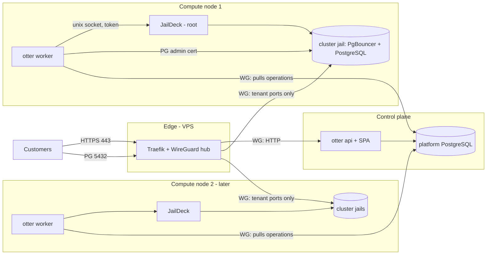

# Architecture Proposal

Status: **proposal for review**, revision 2 (2026-10-19).

Revision 2 changes:

- JailDeck replaces Sylve as the host layer (Q1, accepted; see
  [host-layer.md](host-layer.md)).
- The system is described as a **control plane plus compute nodes**, so that
  the web tier and the tenant workloads can live on different machines and
  more nodes can be added.

Update 2026-10-19: Q3, Q4, Q7, Q9, Q12, Q14, Q17 and Q18 decided. AD-2 and
AD-3 accepted; §10 now describes a pluggable off-site backup target
(AD-11); deletion keeps a final snapshot outside the jail's datasets.

Update 2026-10-21: **shared clusters** (Q20–Q22). Customers get a database
in a shared PostgreSQL cluster behind PgBouncer, not a server of their own.
§4 and §6.1 are new; the jail-per-instance design moves to §6.2 as the
future dedicated tier.

Related: [feasibility](feasibility.md) · [domain model](domain-model.md) ·
[security](security.md) · [roadmap](roadmap.md) ·
[open questions](open-questions.md) · [JailDeck scope](jaildeck-scope.md).

## 1. Shape of the system

Three roles. Each can be a machine, a jail, or share a machine with another
role:

| Role | Components | Holds | Trust |
|---|---|---|---|
| **Edge** (VPS) | Traefik, WireGuard hub | Public IPv4, TLS certificates, DNS token | Semi-trusted |
| **Control plane** | `otter api` (REST + Svelte SPA), platform PostgreSQL | Users, sessions, subscriptions, intent, operations queue | Internet-facing (via edge) |
| **Compute node** (one or more) | **JailDeck** (root), **`otter worker`** (unprivileged, node-scoped), **shared PostgreSQL cluster jails** with PgBouncer (later dedicated jails and VMs) | Customer data, root on that node | Never internet-facing, except tenant service ports |



### The one rule: connection direction

**The control plane never opens a connection to a compute node.**

- Workers connect *out* to the platform DB and pull work.
- The edge connects to the control plane (HTTP) and to nodes (tenant ports
  only).

Consequences:

- An attacker who fully owns `otter api` has no network path to any JailDeck
  instance, and no credential for one. The most they can do is insert rows
  into the operations table. Workers validate those rows against fixed
  operation kinds and platform-generated names.
- Each node's root-equivalent credential (its JailDeck token) exists **only
  on that node**. Compromising one node's worker does not give access to
  other nodes.
- Customer databases keep serving when the control plane is down, because
  their traffic goes edge → node.

### Deployment profiles

The code is identical in every profile. Only where processes run changes.

| Profile | Machines | Layout | When |
|---|---|---|---|
| **Minimum** | 1 node + VPS | Control plane in two jails on the node (`otter-api`, `otter-db`); worker and JailDeck on the node host | Development, M0–M4 |
| **Split** | 1 control-plane box + 1 node + VPS | Control plane on a small separate machine (any 2-core / 4 GB box) or a VPS jail | Optional, any time after M5 |
| **Multi-node** | Control plane + N nodes + VPS | Each node runs JailDeck + worker; placement chooses a cluster (or, for dedicated, a node) per database | When demand outgrows one node |

**Minimum supported node spec** (the reference node, treated as a floor
rather than a target):

- x86-64 CPU with VT-x + EPT, plus Unrestricted Guest for Linux VMs;
- enough RAM for the host, a capped ARC and the platform, with the rest for
  tenants (`feasibility.md` §7);
- a mirrored ZFS pool;
- FreeBSD 15.1.

Capacity is configured per node (`infrastructure_nodes`) rather than assumed,
so a bigger second node simply has bigger numbers.

## 2. Coordination: the database is the queue (no message bus)

The owner asked whether RabbitMQ or OtterMQ should connect the web and
infrastructure layers. **Decided (Q17): not for this path, for now.** The
`operations` table in the platform PostgreSQL is the queue.

| Concern | Operations table | Message bus (RabbitMQ / OtterMQ) |
|---|---|---|
| Atomic with the business write | **Yes.** Instance row + quota check + operation row commit together | No. Needs an outbox table and relay anyway, or risks "instance saved, message lost" and the reverse |
| Durable state of long-running work | The row *is* the state (step, attempts, errors, lease) | Messages are transient; the state must still be persisted elsewhere |
| Recovery after crash | Lease expires, so the job is re-claimed | Redelivery, plus a separate state store to reconcile |
| Routing to a node | `WHERE node_id = $me … FOR UPDATE SKIP LOCKED` | A queue per node |
| Inspectability | `SELECT`; an admin CLI | Separate tooling |
| Extra infrastructure | None (the DB already exists, is backed up, monitored, secured) | Another stateful service to run, secure, back up and monitor, and its outage blocks provisioning |
| Latency | Poll (e.g. 2 s) plus `LISTEN/NOTIFY` for instant wake-up | Instant |
| Throughput needed | Dozens of operations per day | Built for thousands per second |

Workers connect to the DB over WireGuard with a node-specific DB role. That
role can only claim and update operations and instances for its own node,
which is enforced by grants and row-level security, or at least by
constrained functions.

### When a bus would earn its place

- Many independent consumers of the same events: notifications, metering
  and usage records, webhooks to customers, audit export.
- Event volume or fan-out the DB queue handles awkwardly.
- Consumers in other languages or other systems.

When that happens, the pattern is **transactional outbox → relay → bus**:
events are written to an `outbox` table in the same transaction, and a relay
publishes them. The provisioning path stays on the DB.

### Dogfooding OtterMQ: yes, but in the right place

- **Best fit:** a **customer-facing managed service** (roadmap M10, after
  RabbitMQ). OtterMQ instances run in tenant jails, exactly like
  dedicated PostgreSQL. Bugs affect one opted-in tenant, not the platform.
- **Second fit:** the future event stream above (outbox relay → OtterMQ),
  for **non-critical** consumers like notifications or metering, once
  OtterMQ has run as a managed service for a while.
- **Not recommended:** on the provisioning critical path. The platform
  would then depend on a component it is still developing, and an OtterMQ
  bug would stop every create and delete.

## 3. Module boundaries (inside the `otter` binary)

One binary, subcommands `api`, `worker`, `admin`, `migrate`.

| Module | Responsibility | Runs in |
|---|---|---|
| `identity` | Users, accounts, password hashing, sessions, invites | api |
| `catalog` | Service types (code enum) and flavors (DB rows) | api |
| `billing` | Plans, subscriptions, **`Entitlement(account)`**, future payment webhooks | api |
| `instances` | Instance CRUD, ownership, quota, **placement + capacity**, lifecycle commands → operations | api |
| `operations` | Claim with lease, step execution, retries, reconciler loop | worker |
| `postgres` | Service driver: steps for create/start/stop/delete/reset of a database in a shared cluster (later: of a dedicated instance) | worker |
| `jaildeck` | Small HTTP client for the JailDeck API (unix socket) | worker |
| `backup` | Snapshot and dump schedules, retention from `backup_records`, the off-site `Target` implementations | worker |
| `audit` | Append-only audit events | both |
| `httpapi` | Routing, authn/authz middleware, CSRF, rate limits, edge config endpoint | api |
| `config` | Settings from the environment, validated at startup; secrets only from owner-only files | all |

Rules:

- `billing` never imports `instances`; `instances` asks `billing`.
- Only the `jaildeck` package knows JailDeck's API shape.
- Service drivers speak in domain steps (shared:
  `EnsureRole`, `EnsureDatabase`, `EnsurePoolEntry`; dedicated:
  `EnsureJail`, `EnsureDataset`, `EnsureBootstrapped`, `EnsureRole`).
- The api subcommand never loads the `jaildeck` package's credentials.
  The api deployment has none to load.

Interfaces exist only at real boundaries:

- the JailDeck client (fake for unit tests, contract tests against a real
  JailDeck);
- the per-cluster PostgreSQL admin connection (per instance, for dedicated);
- the off-site backup target (§10; `none`, `fs`, `s3`);
- the clock.

There are no repository interfaces over the platform DB. Tests use a real
PostgreSQL.

Dependencies (to install at M1): Go standard library `net/http`, `pgx/v5`,
`goose` (or plain SQL with a tiny runner), `x/crypto/argon2`,
`prometheus/client_golang`, `log/slog`. The frontend uses Svelte 5 +
TypeScript + Vite as a plain SPA, the same choice JailDeck made in JD-015,
so the two UIs share conventions. Added at M7 for backups: `filippo.io/age`
and one S3 client (`minio-go`, which works with any S3-compatible
provider).

## 4. Request flow: create a database

```mermaid
sequenceDiagram
    autonumber
    actor U as User
    participant A as otter api
    participant DB as platform DB
    participant W as otter worker (node N)
    participant JD as JailDeck (node N)
    participant C as cluster jail (PostgreSQL + PgBouncer)

    U->>A: POST /api/instances {name, flavor: db-small}
    A->>DB: BEGIN; lock account; Entitlement(); quota
    A->>DB: choose cluster with capacity; lock cluster row
    A->>A: generate password → SCRAM verifier; allocate names (otc_ab12)
    A->>DB: INSERT instance(provisioning, cluster C), operation(create); audit; COMMIT; NOTIFY ops_N
    A-->>U: 202 {instance, password shown once}
    W->>DB: claim op for node N (SKIP LOCKED, lease)
    W->>C: connect as otter_admin (TLS client cert)
    W->>C: CREATE ROLE (SCRAM verifier) / DATABASE … OWNER … ; REVOKE CONNECT FROM PUBLIC; per-db limits
    W->>C: add the PgBouncer entry for otc_ab12; RELOAD
    W->>DB: instance running, endpoint otc-ab12.db.otter-labs.com; op succeeded; audit
```

No jail is created per customer: the cluster jail already exists. Creating
a cluster is an operator action (`otter admin cluster add`), built from the
same template and JailDeck calls as a dedicated instance (§6.2).

## 5. Operations: async, recoverable, idempotent

These rules are unchanged from revision 1, now node-scoped:

1. **Intent before action.** The instance row, with its platform-generated
   names (database and role `otc_<short-id>`; for dedicated, jail
   `otc-pg-<short-id>` and a tenant IP) and its cluster or node, commits
   together with the operation before anything touches a node.
2. **Every step is an ensure.** SQL steps check the catalog before acting
   (`CREATE ROLE` only if absent, and so on). JailDeck's mutating endpoints
   are themselves idempotent (`PUT` a jail spec: create if absent, succeed
   if it already matches, `409` if it differs).
3. **Checkpoints.** `operations.step` is updated after each step.
4. **Leases.** Claim with `FOR UPDATE SKIP LOCKED` and
   `locked_until = now() + 5 min`, renewed while working. A crashed worker's
   work is re-claimed.
5. **Bounded retries**, then `failed` plus an alert.
6. **One operation in flight per instance** (partial unique index).
7. **Node scoping.** A worker only claims operations whose `node_id` is its
   own.

**Crash between "infrastructure done" and "DB updated":** the name was
persisted first. On retry, the role and database already exist under that
name (or `PUT /api/jails/<name>` returns "already exists, matches"), and
the worker moves on.

### Reconciler (per node, in the worker)

Every 5 minutes and at startup, the worker lists what exists on its node —
databases named `otc_*` in each cluster, PgBouncer entries, and
JailDeck's inventory filtered by the ZFS user property
`otter:instance` — and compares it with the DB rows for its node:

| Observation | Action |
|---|---|
| DB `running`, database (or jail) missing | `failed` ("infrastructure missing"), alert. Never auto-recreate |
| DB `running`, cluster or jail stopped, nothing in flight | Record and alert (auto-start is a later option) |
| Database or jail belonging to an instance that is `deleted` in the DB | Enqueue `delete` (intent is known) |
| `otc_*` database or tagged jail with an unknown instance id | Alert only. Never auto-destroy |
| PgBouncer entry without a database, or the reverse | Fix the PgBouncer entry (it holds no data); alert |
| Health check fails | `health=degraded`, alert |

## 6. PostgreSQL on a node

### 6.1 Shared clusters (MVP; Q20–Q22)

A node runs one **shared cluster** to start with: one hardened VNET jail
holding PostgreSQL and PgBouncer. A customer's database lives in that
cluster. More clusters per node, or per major version, are added by the
operator when one fills up; placement picks a cluster (§8).

#### Datasets

```
<pool>/jails/templates/pg18            @base   ← template (FreeBSD + postgresql18-server + pgbouncer)
                                                  (<pool> is never the OS pool)
<pool>/jails/containers/otc-pgc1               ← cluster jail root: clone of pg18@base
<pool>/jails/containers/otc-pgc1/data          ← PGDATA incl. pg_wal; refquota = the cluster backstop
```

Every tenant database lives in the cluster's default tablespace on `data`.
The Q22 POC showed that a ZFS quota reached by one tenant breaks the
cluster for all of them, so there is no per-tenant quota. Whether each
tenant should still get its own dataset *without* a quota is deferred
pending research (#61); until then there are none.

#### Tenant separation inside the cluster

Tenants share one server process, so the separation is PostgreSQL's own
privilege system (`security.md` R17):

- **One role and one database per customer**, both named `otc_<short-id>`,
  never after the customer. Every user can read database and role names
  from the catalogs, so names must not reveal anything.
- The role owns its database and nothing else. No superuser, `CREATEROLE`,
  `CREATEDB`, replication, or the `pg_*_server_*` roles (Q10).
- `REVOKE CONNECT ON DATABASE … FROM PUBLIC` on every database;
  `pg_hba` only lets each role reach its own database:
  `hostssl <db> <role> <pgbouncer-addr>/32 scram-sha-256`.
- `REVOKE ALL ON SCHEMA public FROM PUBLIC` in each new database (the
  default since PostgreSQL 15, kept explicit).
- No untrusted procedural languages. Extensions from an allowlist,
  installed by the platform.
- Per-database limits set at creation: `CONNECTION LIMIT`,
  `statement_timeout`, `idle_in_transaction_session_timeout`,
  `temp_file_limit`, `work_mem` (Q12).

There is no per-database memory or CPU limit in PostgreSQL. The cluster
jail has rctl limits as a whole; within it, one busy tenant can slow the
others. That is the accepted trade-off for the density (`feasibility.md` §7).

#### PgBouncer (Q21, Q23)

- Runs in the cluster jail. The edge connects to PgBouncer, never to
  PostgreSQL directly.
- One `[databases]` entry per customer database, written by the worker,
  applied with `RELOAD`. Per database: `max_db_client_connections` (the
  flavor's connection limit), `max_db_connections` (a small server pool),
  and `pool_mode` (transaction by default, Q23).
- Authentication: `auth_query` through a dedicated lookup role and a
  `SECURITY DEFINER` function, so PgBouncer reads SCRAM secrets without a
  superuser connection and without a password file to keep in sync.
- `max_prepared_statements` on, so drivers that use protocol-level
  prepared statements work in transaction mode.

#### Storage quota (Q22)

Decided by the POC ([poc-tablespace-quota.md](poc-tablespace-quota.md)):
the **soft quota with a cluster backstop**.

- The worker polls `pg_database_size()` for each database and acts when
  one is over its flavor's storage; the customer is notified. The exact
  steps are designed in M4. Making the database read-only
  (`default_transaction_read_only`) is advisory, because a tenant can
  turn it off in its own session; the step that can't be bypassed is at
  the connection level (PgBouncer `DISABLE`, `ALLOW_CONNECTIONS false`).
- **A PostgreSQL dataset must never reach a ZFS quota.** At a quota, ZFS
  refuses even overwrites (copy-on-write), so dirty pages can't be
  written back: checkpoints fail and crash recovery crawls. The
  `refquota` on `data` is therefore a last resort for the node, sized
  well above the sum of the storage sold on the cluster plus WAL, with
  usage alerts at 80 %.

#### Lifecycle

- **Create:** §4.
- **Stop / start:** `ALTER DATABASE … ALLOW_CONNECTIONS false` plus
  terminating its sessions and disabling its PgBouncer entry; the reverse
  to start. Nothing is released.
- **Reset password:** `ALTER ROLE … PASSWORD '<SCRAM verifier>'`.
- **Delete:** stop; unless `ephemeral`, keep a final `pg_dump`, kept per
  Q7; then `DROP DATABASE`, `DROP ROLE`; remove the PgBouncer entry.
- **Upgrades:** a minor upgrade restarts the cluster for every tenant on
  it. A major upgrade moves everyone at once (`pg_upgrade`), or databases
  move one by one to a new cluster on the new version (dump and restore;
  per-database hostnames make this invisible to clients).

#### What customers don't get

Point-in-time recovery for one database (WAL is cluster-wide), a choice of
major version, superuser, logical replication, server settings, or
extensions outside the allowlist. These are the dedicated tier's reasons to
exist.

### 6.2 Dedicated instances (later tier)

One VNET jail per instance. This was the MVP design before Q20, and it is
kept for customers who need isolation, their own settings or extensions,
or PITR. It is also how cluster jails themselves are built.

#### Datasets


```
<pool>/jails/templates/pg18            @base   ← template (FreeBSD + postgresql18-server + bootstrap script)
                                                  (<pool> is never the OS pool)
<pool>/jails/containers/otc-pg-ab12            ← jail root: clone of pg18@base (no customer data)
<pool>/jails/containers/otc-pg-ab12/data       ← customer data: refquota = flavor storage,
                                                  recordsize=16k, compression=lz4, atime=off,
                                                  mounted at <root>/var/db/postgres
```

Why a separate data dataset:

- **Quota accounting.** A clone's `referenced` space includes the template
  blocks, so the quota goes on `data` only.
- **Snapshots, dumps and rollback** target customer data alone.
- **Upgrades.** A jail's root can be **re-cloned from a newer template while
  keeping `data`**. This is the path for patching the userland and for
  PostgreSQL minor upgrades. Major upgrades use dump/restore or `pg_upgrade`,
  as a documented procedure.

#### Template

Built once per PostgreSQL major version through JailDeck's template
workflow, plus a scripted package step. It contains:

- `postgresqlNN-server`;
- `otter-pg-bootstrap`;
- the platform's admin CA certificate (public).

No SSH or compilers. Tenant jails have **no network egress**, so packages
come only from the template.

#### Bootstrap and secrets

The worker runs `otter-pg-bootstrap` through JailDeck exec, passing only
**non-secret** arguments (sizes, subnets, instance id). The script:

- runs `initdb --auth-local=peer --auth-host=reject`;
- writes `pg_hba`:
  - `hostssl all otter_admin <node-host-ip>/32 cert`;
  - `hostssl <db> <role> <edge-tunnel-ip>/32 scram-sha-256`;
  - reject everything else;
- generates a self-signed certificate for the hop from the edge to the jail;
- starts PostgreSQL.

Then:

- The worker connects as `otter_admin` with **its node's client
  certificate**. No per-instance admin password exists.
- The customer password is generated in `otter api` and shown once. **Only
  its SCRAM verifier** travels, in the operation payload, which is cleared
  on completion. It is applied with `CREATE ROLE … PASSWORD 'SCRAM-SHA-256$…'`.
- The customer role owns one database and is not a superuser
  (Q10: extension allowlist).

#### Deletion

1. Stop.
2. Unless `ephemeral`: snapshot `data` as `@final` and **move it out of the
   jail** (JailDeck dataset rename to `<pool>/jails/retained/<name>`, with
   its mountpoint cleared so it is never mounted again by accident).
   Destroying the jail destroys its child datasets and their snapshots, so a
   snapshot left in place would not survive step 3. Kept 7 days after
   expiry, 3 days after a user delete (Q7); a `final_snapshot`
   BackupRecord carries the `expires_at`.
3. `DELETE /api/jails/<name>`, which destroys the root (and `data`, if it
   was not moved).
4. Verify via inventory.
5. Mark the instance `deleted`, which releases quota and capacity
   implicitly. Retained datasets count against node disk, not the
   customer's quota.

## 7. Networking

```
 Customer ── 443 / 5432 ──▶ VPS: Traefik ≥3.6.8, nftables (22 allowlisted, 443, 5432, 51820/udp)
                              │ wg0 hub
               ┌──────────────┼───────────────────────────┐
               │ peer: control plane      peer: node N    │
               │ AllowedIPs 10.62.0.0/24  AllowedIPs 10.64.N.0/22 (tenant subnet of node N)
               ▼                          ▼
   Control plane (jails or box)     Node N host
   otter-api :8080, otter-db        wg0 ─ PF ─ bridge-tenant 10.64.N.1/22 (no physical NIC)
                                          private members: epairs of cluster jails (later dedicated jails)
                                    LAN interface: home LAN / mgmt, never bridged
```

- **Addressing:** each node owns one tenant subnet (e.g. a `/22` out of
  `10.64.0.0/16`). The edge routes to the right node by WireGuard
  AllowedIPs. Traefik routes by SNI hostname to the PgBouncer of the
  database's cluster (or, for dedicated, to the instance IP). Nodes never
  need to talk to each other.
- **Worker → control-plane DB:** over the node's WireGuard link (split
  profile) or the platform bridge (minimum profile). PF allows only the
  DB port.
- **Static PF policy per node:**
  - tenant → anything: block (logged);
  - edge tunnel IP → tenant `:6432` (PgBouncer; `:5432` for dedicated): pass;
  - node host (worker) → tenant `:5432`: pass (admin connection);
  - tenant → LAN, management, host, control plane: block explicitly.

  There are **no per-instance firewall rules**, so pf.conf is
  hand-maintained and version-controlled. JailDeck gets read-only PF
  visibility (`jaildeck-scope.md` §3.4).
- **VNET jails with `private` bridge membership:** no L2 path between
  tenants.
- **Public endpoints:**
  - wildcard `*.db.otter-labs.com` → VPS IPv4;
  - **one hostname per database** (`otc-ab12.db.otter-labs.com`), even
    though many share a cluster, so a database can move to another cluster
    or node later without clients changing anything;
  - Traefik pulls its dynamic config from `otter api` (HTTP provider over
    WireGuard), listing running databases as hostname → PgBouncer address;
  - the edge has no write path into the platform.
- **DNS (Q14):** the zone is on Cloudflare. Records are **DNS-only (grey
  cloud)**: Cloudflare's proxy does not carry arbitrary TCP without the paid
  Spectrum product, and the edge VPS terminates TLS itself. The VPS holds a
  Cloudflare API token scoped to `Zone:DNS:Edit` on `otter-labs.com` only,
  used solely for ACME DNS-01.
- **TLS (Q4, decided: A):** Traefik terminates with a Let's Encrypt
  wildcard via DNS-01 (Traefik's built-in `cloudflare` provider), so
  customers can use `sslmode=verify-full`. The hop to
  PgBouncer goes over WireGuard, re-encrypted if Traefik supports that for
  PostgreSQL (to test in M0).
- **Portal:** `https://cloud.otter-labs.com` → Traefik → WireGuard →
  `otter-api:8080`, which serves both the SPA and `/api`.
- **IPv6:** out of scope for the MVP.
- **Future VMs:** egress via the edge (`route-to wg0`), never the home IP;
  ports 25/465/587 blocked; rate limits.

## 8. Billing and entitlement

Unchanged from revision 1, and node-independent:

- Eligibility is checked in one transaction: identity → account active →
  ownership → `billing.Entitlement` → quota → **node placement with
  capacity** → flavor active.
- The worker never re-checks billing.
- The payment boundary is expressed in data:
  - `billing_provider='none'`;
  - `payment_status`;
  - paid plans cannot activate without a verified payment event.

  The `PaymentProvider` interface arrives with the first real provider
  (Q11).
- Founder Beta is an ordinary zero-price plan assigned by an operator. No
  code checks for "founder".

### Placement

The simplest rule that works:

- **Shared databases:** among `active` clusters on `active` nodes, pick the
  one with the most free storage capacity after the allocation that still
  has connection headroom.
- **Dedicated instances (later):** among `active` nodes that support the
  service type, pick the one with the most free memory after the
  allocation.

Ties go to the lowest id. Nothing moves automatically. A manual "move"
procedure (dump and restore into another cluster, or `zfs send` of `data`
for dedicated) can be documented later.

## 9. Observability

| Signal | Source |
|---|---|
| App logs | `slog` JSON from api and worker |
| Provisioning history | `operations` table; `otter admin ops` |
| Security events | `audit_events` (platform) **and** JailDeck's audit log on each node, correlated by an `X-Request-Id` / operation id that the worker sends and JailDeck records |
| App metrics | `/metrics` on api and each worker (queue depth, op durations and failures, reconciler drift, capacity) |
| Host metrics | `node_exporter` per node and on the control plane |
| Per-jail CPU, memory, processes | **JailDeck `/metrics`** (proposed; rctl-based). This also fulfils JailDeck's own Metrics milestone without a database, because Prometheus keeps the history |
| Per-database size and connections | The worker: `pg_database_size()`, `pg_stat_database`, PgBouncer `SHOW POOLS` → `otter_db_size_bytes`, `otter_db_client_connections` |
| Instance health | Worker health checks → `otter_instance_up` |
| External reachability | Blackbox probes **from the VPS** to the portal and a canary instance |

Alerts:

- operation failed;
- queue stuck;
- reconciler drift;
- WireGuard handshake stale (per peer);
- worker not claiming (heartbeat);
- disk usage above 80%;
- backup failed or stale.

## 10. Backups and recovery

| Layer | Mechanism | Consistency | Proposal |
|---|---|---|---|
| Local snapshots | Periodic snapshots of each cluster's `data` dataset. Where the node already runs a replication tool that snapshots the jail pool (e.g. `zrepl`), **that tool owns periodic snapshots** and the worker takes only on-demand ones (final, pre-upgrade) via JailDeck | Crash-consistent; PostgreSQL recovers as after a power loss | Per the zrepl pruning policy; target hourly ×24, daily ×7 |
| Local replica (optional) | The replication tool copies the jail pool and the OS pool into a read-only pool on separate disks. Replicas outlive a destroyed source dataset (to verify in M0) | Same as the snapshots | Longer retention than the source |
| Logical | Worker runs `pg_dump -Fc` **per database** as `otter_admin`, to a node-local spool dataset. This is how one tenant is restored without touching the others | Application-consistent | Daily ×7, weekly ×4 |
| Off-site | Each dump is encrypted and handed to the configured **backup target** (below) | Same as the dump | After each dump |
| Platform DB | `pg_dump` on the control plane, same target interface | Application-consistent | Daily ×14 |
| Config | Git repo: pf.conf, WireGuard (no keys), Traefik, rc.conf fragments, template build scripts | — | On change |

### Pluggable off-site target (Q9, AD-11)

Off-site storage is chosen per deployment, not built into the design. The
`backup` module talks to one small interface:

```go
// Target stores opaque, already-encrypted blobs. Keys are chosen by the caller.
type Target interface {
    Put(ctx context.Context, key string, r io.Reader) (Object, error)
    Get(ctx context.Context, key string) (io.ReadCloser, error)
    List(ctx context.Context, prefix string) ([]Object, error)
    Delete(ctx context.Context, key string) error // may return ErrImmutable (object lock)
}
```

| Implementation | Use | Notes |
|---|---|---|
| `none` | Default until a target is configured; development | Writes `skipped` BackupRecords and exports `otter_backup_offsite_enabled 0`. The beta terms must state it if this is what runs |
| `fs` | **Our own solution**: a directory that is really another machine's storage (NFS mount, or a ZFS dataset on a second node or a friend's box) | Simplest self-hosted option; pairs well with a second machine. A writable dataset on a local replica pool also works for development, but it is not off-site |
| `s3` | **Commercial or self-hosted S3-compatible** storage: Backblaze B2, Wasabi, Cloudflare R2, or our own MinIO/Garage | One bucket, a prefix per node plus `control-plane/`. Use object lock and a key without delete rights where the provider supports it |

Rules that keep the interface honest:

- **Encryption is above the interface.** The `backup` module encrypts
  (age, with the public key on the node and the private key offline) and
  hashes before `Put`. No target ever sees plaintext, and a new target
  cannot forget to encrypt.
- **Retention is above the interface.** The worker decides what to delete
  from `backup_records.expires_at`; targets only store, list and delete.
- **Targets are dumb.** No dedup or incremental logic. Dumps at beta scale
  are small; if they grow, a `restic` implementation can be added behind the
  same interface, or snapshots shipped with `zfs send`, without touching
  callers.
- **Configuration is per node.** Each worker has its own target credentials,
  scoped to its own prefix. The control plane never holds node backup
  credentials (consistent with AD-2).
- **Restores are tested per target.** The M7 drills run against the target
  actually configured, not `none`.

Restore procedures to drill before beta (M7):

1. **One database:** `pg_restore` from its dump into a fresh database; or
   clone a snapshot into a scratch cluster and dump from there. Rolling
   back a whole cluster snapshot is never used to restore one tenant.
2. **A whole cluster** from snapshots (all its tenants, same point in time).
3. **Failed provisioning cleanup.**
4. **Node loss.** Reinstall the node, recreate its clusters and
   re-provision its databases (same ids and names) from the latest dumps.
   The control plane is unaffected.
5. **Control-plane loss.** Restore the platform DB from off-site. Nodes and
   customer databases keep running in the meantime.

## 11. Architecture decisions

| # | Decision | Status |
|---|---|---|
| AD-1 | Modular monolith `otter` binary; `api` and `worker` are separate processes with separate privileges | Accepted (Q2) |
| AD-2 | Control plane + compute nodes; the control plane never connects to nodes; workers are node-local and pull work | Accepted (Q18) |
| AD-3 | The platform DB is the operations queue (`SKIP LOCKED`, leases, `LISTEN/NOTIFY`). No message bus on the provisioning path; outbox → bus only when event fan-out appears | Accepted (Q17) |
| AD-4 | **JailDeck** is the host agent on each node: generic, idempotent, synchronous primitives; nothing Otter-specific in it | Accepted (Q1) |
| AD-5 | **Shared clusters:** customers get a database in a shared PostgreSQL cluster per node (one hardened VNET jail), separated by PostgreSQL privileges. One VNET jail per instance becomes the later dedicated tier | Accepted (Q20), replaces "one jail per instance" |
| AD-6 | Worker → cluster (or instance) admin via per-node TLS client certificate; customer passwords travel only as SCRAM verifiers | Proposed |
| AD-7 | Public access via WireGuard to the VPS + Traefik SNI routing; Traefik pulls config; per-node tenant subnets; TLS terminated at Traefik (Q4); Cloudflare DNS-only records (Q14) | Accepted in principle, to test in M0 |
| AD-8 | Quota, placement and capacity enforced in one DB transaction with row locks | Proposed |
| AD-9 | Entitlement computed from the subscription; no founder special cases; payment interface deferred | Proposed (Q11) |
| AD-10 | Static, hand-maintained PF policy per node; no tool rewrites pf.conf | Proposed |
| AD-11 | Off-site backups go through a pluggable `Target` (`none`, `fs`, `s3`); encryption and retention live above it | Accepted (Q9) |
| AD-12 | PgBouncer in front of every shared cluster: per-database client limits, small server pools, `auth_query` with SCRAM | Accepted (Q21) |
| AD-13 | Per-database storage quota: the soft quota with a cluster backstop; no ZFS quota a tenant can reach | Accepted (Q22, POC 2026-10-26) |

Once accepted, these move into `docs/adr/NNNN-*.md`.
