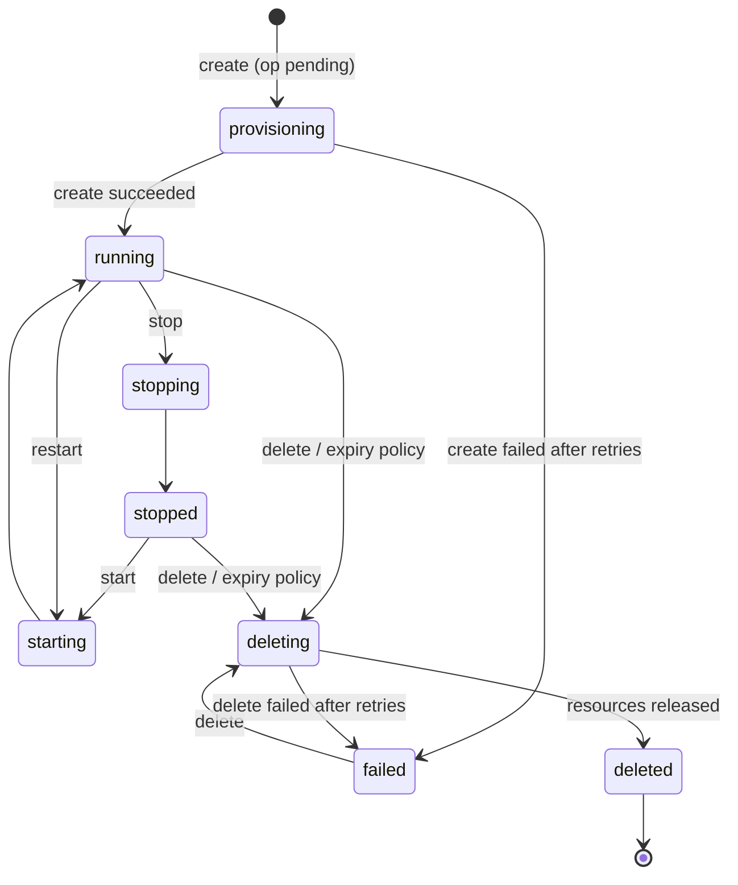

# Domain Model

Status: **proposal for review**. Nothing here is implemented.

Update 2026-10-21: shared clusters (Q20). An `Instance` of service type
`postgresql` is now a **database in a shared cluster**; the new `Cluster`
entity is where those databases live. Dedicated instances (one jail each)
are a later service type, `postgresql-dedicated`.

Update 2026-10-28: customers see a `reason` code, never `last_error`
([portals.md](portals.md) §3); idempotent replays never return the password.

This document proposes the initial domain model, challenges the entity list
from the brief, and explains where commercial, entitlement, allocation and
operational concerns are separated.

## 1. Summary of decisions

| Brief entity            | Proposal                                                                 |
|-------------------------|--------------------------------------------------------------------------|
| User                    | **Keep.** Identity only (login, credentials, sessions).                  |
| Account / Tenant        | **Keep as `Account`.** The ownership and quota boundary. 1 user ↔ 1 account in the MVP. |
| ServicePlan             | **Split in two:** `Plan` (commercial, account-level) and `Flavor` (technical size of one instance). |
| Subscription            | **Keep.** Links an account to a plan; carries a snapshot of the plan's limits. |
| Entitlement             | **Not a table.** A computed value derived from the active subscription. |
| ResourceInstance        | **Keep as `Instance`.** Carries its allocation, desired state and observed status. |
| ProvisioningOperation   | **Keep as `Operation`.** Durable job record; the unit of retry, audit and recovery. |
| InfrastructureNode      | **Keep, minimal.** One row today. Needed for the capacity check and future placement. |
| (new) Cluster           | **Add.** A shared PostgreSQL cluster (one jail with PgBouncer) on a node. Shared databases are placed on a cluster, not directly on a node. |
| (new) AuditEvent        | **Add.** Append-only record of security-relevant actions.               |

## 2. Why these simplifications

### 2.1 Account separate from User, but 1:1 for now

Resources, quotas and subscriptions belong to an `Account`, not to a `User`.
In the MVP every user has exactly one account and every account has exactly
one user (the owner). This costs one extra table and one foreign key, and it
avoids rewriting ownership on every table when teams or shared projects
arrive. No membership table, roles or invitations are built now.

### 2.2 "Service plan" is two different things

The brief uses "service plan" both for *what the customer subscribes to*
("Founder Beta, 2 databases, 10 GB") and for *what they pick when creating a
database* ("PostgreSQL small"). These change for different reasons and must
not be one entity:

- **`Plan`**: commercial. Price, currency, billing interval, and the account-
  level limits it grants. Changed by business decisions.
- **`Flavor`**: technical. The size of one instance of a given service
  type: storage and connections for a shared database; memory, CPU and
  storage for a dedicated one. Changed by infrastructure decisions.

A Founder Beta account with 10 GB of storage can create two `db-small`
(2 GB) databases, or one `db-small` and one `db-medium` (5 GB), or any other
combination that fits. The plan does not need to know which flavors exist.

### 2.3 Entitlement is computed, not stored

An entitlement answers: *"What may this account consume right now?"*
Storing it as its own table creates a second source of truth that must be
kept in sync with subscription and payment state. Instead:

```
Entitlement(account) =
    the limits snapshot of the account's single active subscription,
    if the subscription is active and its payment requirement is satisfied;
    otherwise "not entitled".
```

This lives in **one function** in the billing module,
`billing.AccountEntitlement`. Every other module asks
it; none of them inspect plan names, prices, or founder flags. This is the
mechanism that avoids scattered `if user.IsFounder` checks.

### 2.4 Subscription snapshots the limits

When a subscription is created, the plan's limits are copied onto it. Editing
the "Founder Beta" plan later does not silently change existing subscribers'
quotas; a deliberate migration does. This also lets an operator grant a
one-off override for a single account without creating a new plan.

### 2.5 Operation is the core of reliability

Every infrastructure change goes through an `Operation` row written in the
same database transaction as the state change that requested it. A worker
executes operations; on crash, it picks up whatever was left `running`
or `pending`. This replaces a workflow engine (see `architecture.md` §5).

## 3. Entities

Field lists are indicative, not a schema. Types: `id` is a UUID (or ULID);
timestamps are UTC.

### User

| Field            | Notes                                                    |
|------------------|----------------------------------------------------------|
| id               |                                                          |
| account_id       | Exactly one account in the MVP.                          |
| email            | Unique, normalised.                                      |
| password_hash    | argon2id. Not null: local accounts only (Q3 decided). |
| status           | `active`, `disabled`.                                    |
| is_operator      | Platform staff. Only affects access to operator tooling, **never** billing or quotas. |
| created_at       |                                                          |

Sessions are stored server-side (`sessions` table: hashed token, user_id,
created_at, last_seen_at, revoked_at, created_ip, user_agent). The expiry
is derived: 7 days after `last_seen_at` or 30 days after `created_at`,
whichever is first.

### Invite

| Field       | Notes                                                       |
|-------------|-------------------------------------------------------------|
| id          |                                                             |
| email       | Normalised. Sign-up uses this address; the person can't change it. |
| token_hash  | SHA-256 of the link's random token; the token isn't stored. |
| created_at  |                                                             |
| expires_at  | 72 hours by default.                                        |
| used_at     | Set once; a used invite can't be used again.                |
| user_id     | The user who signed up with it.                             |

Created by an operator with `otter admin invite create`. Kept after use, as
the record of who was invited when.

### Account

| Field       | Notes                                   |
|-------------|-----------------------------------------|
| id          |                                         |
| name        |                                         |
| status      | `active`, `suspended`, `closed`. Suspension is an administrative/security action, distinct from billing. |
| created_at  |                                         |

The account row is also the **lock target for quota checks** (§5).

### Plan (commercial)

| Field                 | Example (Founder Beta)    |
|-----------------------|---------------------------|
| id / code             | `founder-beta`            |
| name                  | Founder Beta              |
| price_minor           | 0 (integer, minor units)  |
| currency              | BRL                       |
| interval              | `month` / `none`          |
| requires_payment      | false (derived: price > 0)|
| max_instances         | 2                         |
| max_storage_gb        | 10                        |
| max_connections       | 60 (sum over the account's databases) |
| max_memory_mb         | 0 (dedicated instances only) |
| max_vcpu              | 0 (dedicated instances only) |
| max_lifetime          | null (or e.g. 30 days for a "trial" plan). Not in the schema yet |
| public                | false (assigned by operator, not self-service) |
| active                | true                      |

Plans are rows in the database, synced by `otter migrate` from the reviewed
file `internal/billing/plans.json` (#42). They are never deleted, only
deactivated, so historical subscriptions remain valid. Name, limits and
visibility may change, and apply only to later subscriptions; price,
currency and interval are fixed once a plan exists, because they decide
whether its subscriptions owe money. `requires_payment` is a generated
column.

### Flavor (technical)

| Field           | Example (shared)  | Example (dedicated, later) |
|-----------------|-------------------|----------------------------|
| code            | `db-small`        | `pg-small`                 |
| service_type    | `postgresql`      | `postgresql-dedicated`     |
| name            | Small             | —                          |
| storage_gb      | 2                 | 5                          |
| max_connections | 20                | —                          |
| memory_mb       | —                 | 512                        |
| vcpu            | —                 | 1 (see note)               |
| active          | true              | true                       |

Shared values decided in Q12 (`db-medium`: 5 GB, 30 connections);
dedicated values are proposals.

Flavors come from `internal/catalog/flavors.json`, a reviewed file shipped
with the binary, and `otter migrate` syncs them on every run (#41). **A
flavor's sizes never change once it exists**: instances copy their
allocation from it, and a code means one size for its whole life, so a new
size is a new code, and a sync that changes sizes is refused. Dropping a
flavor from the file deactivates it; rows are never deleted. `service_type` is a small enum in code
(`postgresql`, a database in a shared cluster, for the MVP;
`postgresql-dedicated`, `redis`, `rabbitmq`, `vm` later). Each service type has a code-level driver that knows
how to provision it; there is no generic plugin system.

> **Note on vCPU for jails.** Jails do not have vCPUs. A jail's CPU allocation
> is enforced as an `rctl` `pcpu` percentage and/or a `cpuset`. For quota
> purposes, "1 vCPU" means "up to 100% of one core". See `feasibility.md`.

### Subscription

| Field               | Notes                                                  |
|---------------------|--------------------------------------------------------|
| id                  |                                                        |
| account_id          | At most **one non-terminal** subscription per account (partial unique index). |
| plan_id             |                                                        |
| status              | `pending`, `active`, `suspended`, `canceled`, `expired` |
| payment_status      | `not_required`, `pending`, `current`, `past_due`       |
| max_*               | Snapshot of plan limits at creation (+ operator override), with `requires_payment`. |
| current_period_end  | Nullable. Null for open-ended founder subscriptions.  |
| starts_at / ends_at |                                                        |
| billing_provider    | `none` for the MVP. Future: `stripe`, `mercadopago`, … |
| external_ref        | Nullable. The provider's subscription ID, later.       |
| created_at          |                                                        |

Two separate state fields are deliberate:

- **`status`** is the agreement: does the customer have a subscription?
- **`payment_status`** is the money: is the payment obligation satisfied?

A founder subscription is `status=active, payment_status=not_required`.
A future paid subscription is created `status=pending, payment_status=pending`
and becomes `active` **only** when a verified payment event arrives (webhook
handler in the billing module). The provisioning code never sees either
field; it sees the entitlement result.

### Instance (resource)

| Field             | Notes                                                    |
|-------------------|----------------------------------------------------------|
| id                |                                                          |
| account_id        | Owner. Every query is scoped by this.                    |
| name              | User-facing name, unique per account.                    |
| service_type      | `postgresql` (shared database); later `postgresql-dedicated`, … |
| flavor_code       |                                                          |
| storage_gb, max_connections, memory_mb, vcpu | **Allocation**, copied from the flavor at creation (unused fields null). |
| cluster_id        | Placement of a shared database. Null for dedicated.      |
| node_id           | The node it runs on (the cluster's node, for shared).    |
| infra_name        | Deterministic infrastructure name: `otc_<short-id>` (database and role) or `otc-pg-<short-id>` (dedicated jail). Used for idempotency and reconciliation. |
| tenant_ip         | Dedicated only: address in the node's tenant subnet, allocated by the platform. Persisted **before** calling the node, together with `infra_name`. |
| desired_state     | `running`, `stopped`, `deleted` — what the user asked for. |
| status            | Observed lifecycle state (§4).                           |
| health            | `ok`, `degraded`, `unknown` — from health checks; orthogonal to lifecycle. |
| reason            | Why the instance is in its status, as a code from a fixed list (`create_failed`, `delete_failed`, `over_storage_quota`, `expired`, `suspended`, …). Customer-safe: the API maps each code to a message the platform wrote. Never free text. |
| endpoint_host, endpoint_port | Connection info.                              |
| expires_at        | Nullable. Resource lifetime, independent of subscription. |
| created_at, deleted_at |                                                     |

Credentials are not stored. The customer password is shown once at creation
and can be reset; only its SCRAM verifier travels in the operation payload.
See `architecture.md` §6 and `security.md` §6.

### Operation

| Field           | Notes                                                       |
|-----------------|-------------------------------------------------------------|
| id              |                                                             |
| instance_id     |                                                             |
| account_id, node_id | Copied from the instance: the account's history (#77), and the worker that claims it (M3). |
| kind            | `create`, `start`, `stop`, `restart`, `delete`, `reset_password`, `expire` |
| status          | `pending`, `running`, `succeeded`, `failed`, `canceled`     |
| step            | Last completed step within the kind (e.g. `role_created`, `database_created`, `pool_entry_added`; dedicated: `jail_created`, `pg_initialized`). |
| attempts        |                                                             |
| next_attempt_at | For backoff.                                                |
| locked_by, locked_until | Worker lease, so a crashed worker's job is reclaimed. |
| requested_by    | User ID, operator ID, or `system` (expiry, reconciler).     |
| idempotency_key | Optional, from the API client's `Idempotency-Key` header; unique per account. A replay returns the existing instance and operation, never the password (it was not kept). |
| payload         | Small JSON of non-secret inputs (e.g. SCRAM verifier for `create`/`reset_password`). Cleared when the operation finishes. |
| reason          | Customer-safe reason code, as on Instance; set when the operation fails. |
| last_error      | The internal error. **Operator only:** logs and `otter admin`, never an API response, because it can name hosts, clusters or SQL. |
| created_at, started_at, finished_at |                                         |

Rule: **at most one non-terminal operation per instance** (partial unique
index). A second request while one is in flight is rejected with `409`.
This removes a whole class of race conditions (stop during create, delete
during start) without any locking logic in the worker.

### InfrastructureNode

| Field                 | Notes                                        |
|-----------------------|----------------------------------------------|
| id / name             | `node-01`                                    |
| status                | `active`, `draining`, `offline`              |
| capacity_memory_mb    | **Configured**, not discovered: host RAM minus host, ARC and platform reservations. |
| capacity_vcpu         | Configured, with an explicit overcommit ratio. |
| capacity_storage_gb   | Configured per pool.                         |
| tenant_subnet         | e.g. `10.64.0.0/22`; the source of tenant IPs and the edge's WireGuard AllowedIPs for this node. |
| service_types         | Which service types this node may host (e.g. VMs only on nodes with UG). |

Used capacity is **computed** from the sum of allocations of instances placed
on the node that are not `deleted`. It is not stored, so it cannot drift.

The node table holds **no credentials and no endpoint**. The control plane
never connects to nodes; each node's worker identifies itself (its own DB
role) and pulls operations for its `node_id` (`architecture.md` §1–2).
Placement picks a node inside the create transaction (§5).

### Cluster

| Field                 | Notes                                        |
|-----------------------|----------------------------------------------|
| id / name             | `pgc1`                                       |
| node_id               | The node whose cluster jail it is.           |
| pg_major              | e.g. 18. One major version per cluster.      |
| status                | `active`, `draining` (no new databases), `offline` |
| jail_name, pool_addr, pool_port | `otc-pgc1`; the PgBouncer address in the node's tenant subnet (and port, 6432), for the edge. |
| memory_mb             | The cluster jail's memory limit, reserved on its node. |
| capacity_storage_gb   | Configured: what the cluster's datasets may hold for tenants. |
| capacity_connections  | Configured: total client connections the cluster accepts (sum of database limits). |
| capacity_databases    | Configured upper bound on databases.         |

Created by an operator (`otter admin cluster add`), not by customers. Used
capacity is **computed** from the databases placed on it, as for nodes. The
cluster jail's own rctl budget (`memory_mb`) counts against its node's
memory capacity: adding a cluster is refused when the node's clusters
together would need more memory or storage than the node is configured
with (#43). Capacities are set at add; the operator can only change a
node's or cluster's status (`drain`, `activate`). Two nodes' tenant subnets
never overlap (an exclusion constraint).

### AuditEvent

| Field        | Notes                                                     |
|--------------|-----------------------------------------------------------|
| id, at       |                                                           |
| actor        | user id / `system` / operator id                          |
| account_id   | Nullable                                                  |
| action       | `auth.login`, `auth.login_failed`, `instance.create`, `instance.delete`, `subscription.create`, … |
| target       | Entity type + id                                          |
| ip, user_agent |                                                         |
| outcome      | `ok`, `denied`, `error`                                   |
| details      | Small JSON, **never** secrets.                            |

Append-only: the application DB role has `INSERT` and `SELECT` on this table
but no `UPDATE`/`DELETE`.

### BackupRecord (operator-only)

One row per backup artifact the platform knows about: a local snapshot, a
logical dump, or an off-site copy of a dump. It exists so retention,
restore and "when was this last backed up?" are answered from the DB, not
by listing storage. Not shown to customers in the MVP.

| Field        | Notes                                                     |
|--------------|-----------------------------------------------------------|
| id           |                                                           |
| instance_id  | Nullable: null for the platform DB's own backups.         |
| node_id      | Where the artifact was produced.                          |
| kind         | `snapshot`, `dump`, `final_snapshot`.                     |
| target       | `local` for snapshots and on-node dumps, otherwise the configured off-site target name (`none`, `fs`, `s3`, …). |
| ref          | Snapshot name or the target's object key. Opaque to everything but the target implementation. |
| size_bytes, sha256 | sha256 of the stored (encrypted) bytes; checked on restore. |
| status       | `ok`, `failed`, `skipped` (target is `none`).             |
| created_at, expires_at | Retention is enforced by the worker from `expires_at`. |

With the `none` target, off-site rows are written as `skipped`, so the gap
is visible in the DB and in metrics rather than silent.

## 4. Instance lifecycle

The brief's list (Requested, Provisioning, Running, Stopped, Failed,
Deleting, Deleted) is close. Two changes are proposed:

1. **Separate desired state from observed status.** The user expresses
   intent (`desired_state`); the worker and reconciler move `status` toward
   it. This makes "what should be true" explicit, which is exactly what the
   reconciler needs after a crash.
2. **Add transitional `starting`/`stopping`**, and drop `requested` (an
   instance with `status=provisioning` and a `pending` operation already
   means "requested").



`failed` always carries a `reason`, which the customer sees, and the
operation's `last_error`, which only the operator sees
([portals.md](portals.md) §3).
A `failed` instance still counts against quota and capacity until it is
deleted, because it may still hold a dataset on disk.

`deleted` rows are kept (soft delete) for audit and billing history.

## 5. Quota and capacity check (concurrency-safe)

All of the following happens in **one database transaction** when the API
accepts a create request:

```sql
BEGIN;
SELECT ... FROM accounts WHERE id = $account FOR UPDATE;   -- serialises this account
-- entitlement: active subscription + payment requirement satisfied
-- usage:  SUM(storage_gb, max_connections, memory_mb, vcpu), COUNT(*) FROM instances
--         WHERE account_id = $account AND status <> 'deleted'
-- check:  usage + flavor <= subscription limits
-- placement (shared): among active clusters on active nodes, pick the one with
--            most free storage after allocation and connection headroom; lock it:
SELECT pg_advisory_xact_lock(...) per eligible cluster, in id order;  -- serialises placement
-- capacity (re-checked under the lock): SUM(allocations on cluster) + flavor <= capacity
-- (dedicated, later: the same against infrastructure_nodes and memory)
INSERT INTO instances (..., status='provisioning', desired_state='running');
INSERT INTO operations (..., kind='create', status='pending');
INSERT INTO audit_events (...);
COMMIT;
```

Two concurrent requests for the same account serialise on the account row
lock; the second one sees the first one's instance in its `SUM` and is
rejected if over quota. The cluster locks do the same for physical
capacity: every eligible cluster is locked, in id order, before usage is
summed and one is chosen, so no two creates can each take the last slot.
They are transaction-scoped advisory locks rather than `FOR UPDATE`,
because otter api may read clusters but not update them (#44). Both locks
are proven by tests that fail without them (20 parallel creates against a
quota of 2; 8 accounts racing for a cluster with 3 slots).
At 5–10 users the contention is irrelevant.

This is the whole "resource manager" for the MVP: no reservation tables, no
external lock service.

### Allocated vs. reserved vs. actual

| Term          | Meaning in this platform                                                    | Where it lives |
|---------------|------------------------------------------------------------------------------|----------------|
| **Allocated** | What the customer is entitled to use for an instance (its flavor). Counts against the *account quota*. | `instances` row |
| **Reserved**  | Capacity held so that the allocation can actually be honoured. A shared database reserves storage and connections on its *cluster*; the cluster jail reserves memory on its *node*. A dedicated instance reserves memory on its node, including while `stopped` (Q8). | computed from `instances` + cluster and node config |
| **Actual**    | Measured consumption (RSS, CPU %, bytes on disk).                            | Prometheus, not the platform DB |

Beta policy: storage is **not overcommitted** (ratio 1.0); connections are
limited per database by PgBouncer and summed per cluster. For dedicated
instances, memory is not overcommitted and CPU modestly (e.g. 2.0). Ratios
are configuration.

## 6. Expiration (two separate clocks)

| Clock                    | Field                         | Effect on expiry |
|--------------------------|-------------------------------|------------------|
| Resource lifetime        | `instances.expires_at`        | Expiry policy applied to that one instance. |
| Subscription lifetime    | `subscriptions.ends_at` / `current_period_end` | Account loses entitlement: no new instances; existing ones follow the suspension policy. |

Policy (Q7, accepted 2026-10-19):

1. At `expires_at`: instance is **stopped**, not deleted. User is notified.
2. After a 7-day grace period still expired: a final copy is retained (a
   snapshot of the tenant's dataset, or a final `pg_dump` for a shared
   database without one), then the instance is deleted.
3. The final snapshot is kept for 7 days, then destroyed.
4. A user-requested delete also retains a final snapshot, kept 3 days
   (recovery by an operator only).

Temporary environments that the user explicitly marks as disposable
(`ephemeral=true` at creation, with clear UI wording) skip the grace
period and the final snapshot. This is opt-in per instance; persistent data is never deleted
automatically without a documented policy.

## 7. What is intentionally not modelled yet

- Teams, memberships, roles beyond owner/operator.
- Invoices, payments, payment history, usage records, metering.
- Multiple subscriptions per account, add-ons, proration.
- Regions, placement policies beyond "most free memory", instance migration
  between nodes.
- Instance resizing.
- Backups as customer-visible objects (BackupRecord exists, but backups are
  operator-managed in the MVP).

Each can be added as new tables without changing the entities above.
