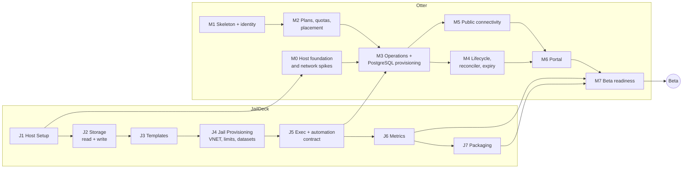

# Development Roadmap

Status: **proposal for review**, revision 2 (2026-10-19): JailDeck replaces
Sylve, and the system is a control plane plus compute nodes.

Two tracks run in parallel. They meet at Otter M3:

- **JailDeck track (J):** host-agent capabilities, in the JailDeck repo
  ([jaildeck-scope.md](jaildeck-scope.md) §6).
- **Otter track (M):** the cloud platform, in this repo.

Estimates assume one developer, part-time. They are for sequencing only.

Critical path: **J1 → J5 → M3.** M1 and M2 need no infrastructure and
proceed while the JailDeck track catches up.

---

## JailDeck track (summary; details belong in JailDeck's ROADMAP)

Applied to JailDeck's docs on 2026-10-21 and tracked as GitHub issues
[ottermq/jaildeck#1–#18](https://github.com/ottermq/jaildeck/issues), with milestones
named after JailDeck's and an `otter` label.
JailDeck names its milestones instead of numbering them; J1–J9 are this
document's shorthand. J2 is JailDeck's *Storage Visibility* plus *Storage
Writes*, J5 is *Exec and Automation Contract*, J8 is *Firewall Visibility*,
J9 is *Virtual Machines*; the rest keep their names.

| | Milestone | Acceptance (as Otter needs it) |
|---|---|---|
| J1 | Host Setup | `jaildeck` reports pool layout, racct status, VT-x/EPT/UG, tenant bridge and devfs ruleset presence |
| J2 | Storage read + write | List datasets, snapshots, user properties; create child datasets with properties; snapshot, rollback, destroy (with confirm) |
| J3 | Templates | Release template to `@base`. A derived template (base + `postgresql18-server` + bootstrap script) can be produced and snapshotted |
| J4 | Jail Provisioning | `PUT /api/jails/{name}` with the full spec (VNET private member, rctl, cpuset, allowlisted params, child datasets, user properties) is idempotent; destroy with confirm removes everything |
| J5 | Exec + automation | Exec endpoint, unix socket listener, `X-Request-Id` in the audit log, API change policy in CHANGELOG |
| J6 | Metrics | `/metrics` with per-jail CPU, memory and processes |
| J7 | Packaging | rc.d service, install docs. A node can be rebuilt from docs |
| J8 | PF visibility | Read-only PF view |
| J9 | VMs | JD-019 spike → `vms` domain (needed for Otter M9) |

---

## M0: Host foundation and network spikes

**Goal:** a correctly prepared node, plus proof that the network path and
TLS routing work, before platform code depends on them.

**Scope (scripts and notes; no Otter application code):**

Step-by-step procedure: [runbook-m0.md](runbook-m0.md).

1. ~~Record node facts~~: done 2026-10-20 after the reinstall (UG present;
   storage layout as planned; disk health monitored). See `feasibility.md`
   §2; the node's specifics are in the operator's notes.
2. Host baseline:
   - FreeBSD 15.1 (done, p5);
   - `kern.racct.enable=1` in `/boot/loader.conf` (currently off) + reboot;
   - `vfs.zfs.arc.max`;
   - jail `exec.timeout` per JailDeck JD-014;
   - devfs ruleset;
   - tenant bridge (no physical member);
   - **pf.conf** (static policy) in a Git-tracked host-config directory;
   - decide where any non-Otter jails live relative to tenants
     (`security.md` R16).
3. JailDeck installed and running as root (current `dev` plus J1).
4. A PostgreSQL jail created **by hand** (or with an early JailDeck branch)
   following the exact layout of `architecture.md` §6:
   - root clone plus `data` dataset with `refquota`;
   - VNET private member;
   - rctl;
   - bootstrap script.

   This becomes the reference that J3/J4 automate.
5. WireGuard node ↔ VPS: CGNAT check, MTU, keepalive.
6. Traefik ≥ 3.6.8 on the VPS:
   - SNI routing with psql 16 (SSLRequest), psql 17/18 (direct TLS), pgx and
     JDBC;
   - TLS termination vs passthrough;
   - HTTP-provider config pull.
7. Isolation script: `nc` probes from a tenant jail to the LAN, host, other
   tenant, control-plane addresses and the internet; from the VPS to ports
   that should not be allowed.

**Acceptance:**

- From outside the home network, `psql "host=spike.db.otter-labs.com
  sslmode=verify-full"` (or `require`, per Q4) reaches the reference jail.
- The isolation script passes.
- `feasibility.md` §8 items are marked VERIFIED or FAILED.

**Risks:**

- ~~UG missing~~: UG confirmed 2026-10-20.
- CGNAT MTU problems.
- Traefik PostgreSQL TLS behaviour.

**Effort:** 1–2 weeks. It can overlap with J1–J3 and with M1.

---

## M1: Platform skeleton and identity

- Repo layout and the `otter` binary (`api`, `worker`, `admin`, `migrate`).
- CI: build, vet, staticcheck, govulncheck, tests against PostgreSQL.
- Schema: users, accounts, sessions, invites, audit_events.
- Invite → sign-up → login → logout → `/api/me`.
- CSRF, login rate limiting, slog, `/healthz`, `/metrics`.
- `otter admin invite create`, `user disable`.

**Acceptance:**

- Integration tests: invite valid, expired and reused; login ok, fail and
  rate-limited; logout revokes the session; audit rows written.
- The api DB role cannot modify audit_events.

**Dependencies:** none. **Effort:** 1–2 weeks.

---

## M2: Plans, subscriptions, entitlements, quotas, placement

- Tables: plans, subscriptions, flavors, **infrastructure_nodes** (seeded
  from reviewed config).
- `billing.Entitlement`.
- `instances` records with the full eligibility transaction, including
  **placement across nodes**. Operations rows are created but not yet
  executed.
- `otter admin subscription create`, `otter admin node add|drain`.
- `GET /api/catalog`, `GET /api/subscription`, `POST/GET/DELETE /api/instances`.

**Acceptance:**

- No subscription → 403.
- A paid plan cannot activate.
- Over quota → 409, naming the limit.
- No node with capacity → 409/503.
- **20 parallel creates against a quota of 2 → exactly 2.**
- Placement picks the node with the most free memory. A draining node is
  never chosen.
- Cross-account access → 404.
- No plan codes or prices referenced outside `billing` (CI grep).

**Dependencies:** M1. **Effort:** 1 week.

---

## M3: Operations engine and PostgreSQL provisioning

- `operations`:
  - node-scoped claim with lease;
  - checkpoints, retries, backoff;
  - `LISTEN/NOTIFY` wake-up;
  - a node-specific DB role restricted to its own rows.
- `jaildeck` client (unix socket, token, request id), with contract tests
  against a real JailDeck (tagged).
- `postgres` driver:
  - EnsureJail (PUT spec), start, EnsureBootstrapped (exec), EnsureRole
    (cert-auth connection);
  - delete.
- SCRAM-verifier password flow.
- Deployment, minimum profile:
  - `otter-api` and `otter-db` jails created via JailDeck;
  - worker as an unprivileged rc.d service on the node.

**Acceptance:**

- Via curl on the real node: create → `running` → connect from the node
  with the returned password → delete. The jail and both datasets are gone,
  and quota usage returns to 0.
- **Crash test:** kill the worker at each step. On restart the operation
  completes without duplicates or orphans.
- Fake-JailDeck unit tests cover retry, adopt-existing (`PUT` → 200
  unchanged), spec conflict (409 → failed with reason), and permanent
  failure.

**Dependencies:** M0, M2, **J4, J5**. **Effort:** 2–3 weeks. *Highest risk.*

---

## M4: Lifecycle, reconciler, expiry

- Start, stop, restart. One operation per instance (409).
- Per-node reconciler using JailDeck inventory and `otter:instance`
  properties.
- Health checks → `health`, `otter_instance_up`.
- Expiry policy (Q7). Password reset.
- `otter admin ops list|retry|cancel`, `instances list`.

**Acceptance:**

- A jail destroyed behind the platform's back → `failed` plus an alert.
- A tagged orphan of a `deleted` row is cleaned up. An unknown tag only
  raises an alert.
- Expiry stop and delete behave correctly under a fake clock.

**Dependencies:** M3. **Effort:** 1–2 weeks.

---

## M5: Public connectivity

- An edge config endpoint on `otter api` (WireGuard-bound) for Traefik's
  HTTP provider.
- `deploy/vps/` Traefik and nftables config, with the TLS mode per Q4.
- Connection info in the API.
- Portal published at `cloud.otter-labs.com`.

**Acceptance:**

- External `psql` connects within 60 seconds of `running`.
- After delete, the route is gone within the poll interval.
- The isolation script still passes.

**Dependencies:** M0, M3. **Effort:** 1 week.

---

## M6: Customer portal (Svelte 5 + Vite SPA)

Pages:

- login and invite sign-up;
- dashboard (subscription, quota usage);
- create instance;
- instance detail: status, connection info, start/stop/restart, reset
  password, delete with name confirmation;
- operation history.

**Acceptance:** the brief's 10-step MVP scenario, done by a person on another
network, recorded as a checklist run.

**Dependencies:** M4, M5. **Effort:** 1–2 weeks.

---

## M7: Beta readiness

- Backups:
  - snapshot schedule for `data` datasets;
  - nightly `pg_dump` per instance and of the platform DB;
  - the `backup.Target` interface with `none`, `fs` and `s3`; age
    encryption; retention from `backup_records` (Q9, AD-11). Which target
    the beta runs on is a deployment choice; the drills use that target.
- Restore drills: an instance, the platform DB, node rebuild from docs.
- Prometheus scrape configs (workers, api, JailDeck `/metrics`,
  node_exporter), a Grafana dashboard, alerts, and a blackbox probe from
  the VPS.
- Scheduled isolation script with alerting.
- Secret rotation runbook.
- Security checklist (`security.md` §9).
- Beta terms and a privacy notice (Q15). User onboarding doc.

**Acceptance:**

- Every checklist item ticked.
- Drills timed and documented.
- Alerts fire in simulations: worker stopped, WireGuard down.

**Dependencies:** M6, J6, J7. **Effort:** 1–2 weeks.

### → Beta launch (≈5 founder users, minimum profile)

---

## Post-MVP (re-evaluate after the beta)

| Milestone | Content | Prerequisite |
|---|---|---|
| M8 Hardening | TOTP 2FA; per-tenant ZFS encryption evaluation; I/O limits; beta feedback | Beta |
| M8b Split profile | Move `otter api` + platform DB to a separate box or VPS; dedicated WireGuard link for worker → DB | Optional; any time after M5 |
| M9 Linux VMs | JailDeck J9 (`vms`); Otter `vm` service driver with cloud-init; SSH via edge (port-per-VM or bastion); VM egress via edge with abuse controls | UG verified; RAM capacity; J9 |
| M10 More managed services | Redis, RabbitMQ, then **OtterMQ and GoodiesDB as dogfooded managed services** (new driver plus template each) | M3 patterns stable; GoodiesDB auth, crash-durability and packaging fixes ([goodiesdb-assessment.md](goodiesdb-assessment.md) §4) |
| M11 Second node | `otter admin node add`, second worker + JailDeck, tenant subnet + WireGuard peer; placement already supports it | Demand |
| M12 Real payments | Payment provider in `billing`, webhooks → `payment_status`; evaluate Brazilian options (Pix, Mercado Pago, Stripe BR) | Legal/tax; TOTP; external review |
| Later | Outbox → event bus (possibly OtterMQ) for notifications and metering; teams; customer-visible backups | Real need |

## Technical risks (ranked)

| # | Risk | Mitigation | Known by |
|---|---|---|---|
| T1 | **JailDeck track takes longer than expected** (now on the critical path) | Keep J-scope to generic primitives; the M0 hand-built reference jail defines exactly what J3–J5 must automate; M1/M2 proceed in parallel | J4/J5 |
| T2 | Scope creep inside JailDeck (VMs, PF writes) before Otter's MVP | JailDeck order puts Otter-critical items first; VMs and PF writes after J7 | Ongoing |
| T3 | Traefik PostgreSQL SNI/TLS behaviour | M0 test matrix; port-per-instance fallback | M0 |
| T4 | Residential connectivity (CGNAT, MTU, ISP ToS) | WireGuard tuning; external monitoring; users informed | M0 |
| T5 | Node RAM on a minimum-spec node | Strict capacity checks; small flavors; more RAM or a second node | M2/M3 |
| T6 | HDD IOPS on the minimum spec | Monitor; NVMe mirror later (Q6) | M3/beta |
| T7 | Single node failure | Backups, drills, honest beta terms; control plane survives node loss | M7 |
| T8 | VNET + rctl + `service jail` interplay on 15.1 (autostart, hooks) | Hand-built reference jail in M0 | M0 |

## Suggested order for the next weeks

1. ~~Apply the JailDeck doc changes~~: done 2026-10-21 (Q19). **Now:** start
   M1 in this repo.
2. M0 items 1–3 on the node while J1 lands.
3. M0 item 4 (the hand-built reference PostgreSQL jail) fixes the spec for J3/J4.
4. M0 items 5–7 (network) while M2 is implemented.
5. J3 → J4 → J5, then M3.
