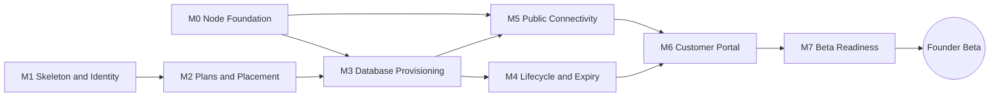

# Development Roadmap

Status: **revision 3, proposal for review** (2026-10-26). Revision 2
(2026-10-19/21) set the shape: a control plane plus compute nodes, JailDeck
as the host agent, shared PostgreSQL clusters (Q20–Q22). Revision 3 slices
it for implementation: **milestones** for delivery order, **epics** for
capability areas, and **issues** small enough to finish in one to three
days.

The target is the **Founder Beta**: about five invited users, one node, the
minimum deployment profile (`architecture.md` §1), databases in a shared
cluster.

Estimates assume one developer, part-time. They are for sequencing only.

## How the work is organised

The same scheme JailDeck uses, plus epics:

- **Milestones** are delivery slices, done in order. Each has a goal,
  capabilities, technical tasks and completion criteria, and becomes a
  GitHub milestone with the same name. A milestone is done when its
  completion criteria pass on the real node, not when its issues close.
- **Epics** are capability areas that span milestones, e.g. "Identity and
  access". Each is a GitHub issue labelled `epic` with a checklist of its
  issues, so it shows how far an area has come across milestones.
- **Issues** belong to one milestone and one epic. Each body ends with
  `Roadmap milestone: **<name>** · Epic: #<n>` and has its own acceptance
  criteria.
- **Labels:** `epic`; `ops` (work on the node or VPS, not code); `spike`
  (a question answered by trying); `decision` (needs the owner; mirrors a
  question in [open-questions.md](open-questions.md)); `jaildeck` (needs or
  found something on JailDeck's side); `postponed` (off its milestone until
  a prerequisite is resolved); plus `enhancement`, `documentation`,
  `security`.
- **Issues are opened one milestone ahead.** M0–M3 get issues now; M4–M7
  stay as bullets here until M2 is done, so their issues are written
  against what was actually built.
- **JailDeck gaps become JailDeck issues** when the Otter issue that needs
  them is picked up, labelled `otter` there and `jaildeck` here, linked
  both ways. Otter works around a gap only when the workaround is recorded.
- **Releases follow milestones** (decided 2026-10-28). A milestone that
  meets its completion criteria is released, and its number is the minor
  version: v0.2.0 is everything through M2, v0.3.0 through M3, and so on
  to v0.7.0 and the Founder Beta. v1.0.0 waits for an API that is stable
  after the beta. Fixes in between are patch releases (v0.2.1). M0 and M1
  have no release of their own: v0.2.0 is the first.
  - **How:** a pull request from `dev` into `main`, the tag `vX.Y.Z` on
    `main`, a GitHub release, and an entry in [CHANGELOG.md](../CHANGELOG.md),
    the way JailDeck does it. Work in progress goes under *Unreleased* as
    it merges.
  - **Artifacts:** none until there is something to deploy. From M3, when
    the worker runs on a node, a release attaches a FreeBSD amd64 binary
    built and attested in CI; a package in the signed repository can follow.

## Where JailDeck stands

As of JailDeck v0.16.1 (2026-10-27), every JailDeck milestone Otter
depends on is done: Host Setup, Storage Visibility and Writes, Templates,
Jail Provisioning, Exec and Automation Contract, Metrics, Firewall
Visibility, Packaging and Distribution (a native `.pkg` and a signed
package repository, so nodes upgrade with `pkg`), and Virtual Machines
(create from an image with cloud-init, start, stop, destroy). The cluster
jail no longer has to be built by hand: M0 builds it through JailDeck's
API, which tests that API against Otter's needs at the same time.

**Known gaps and how Otter handles them until they are closed:**

| Gap | Matters for | Until closed |
|---|---|---|
| No API to destroy a retained dataset or a jail's child dataset ([jaildeck#120](https://github.com/ottermq/jaildeck/issues/120)) | M4 expiry and deletion (Q7) | Deletion stops after "retain" and the operator destroys by hand |
| An existing jail's limits can't be changed: `PUT /api/jails/{name}` answers `409` on any difference ([jaildeck#119](https://github.com/ottermq/jaildeck/issues/119)) | Resizing a cluster jail when its node gains memory | Recreate the jail, keeping `data` (retain, destroy, create, restore); operator-driven |
| Retaining a child with a local `mountpoint` remounts it at the old jail path ([jaildeck#121](https://github.com/ottermq/jaildeck/issues/121)) | M4 deletion, M7 restore | **Convention:** Otter never sets `mountpoint` on a child dataset; children inherit `<jail path>/<child>` |
| Child dataset names are one component (no `/`) | Any nested child dataset (none planned since Q22) | **Convention:** flat names |
| `exec` has no stdin (by design) | Writing `pgbouncer.ini` | Pass the content as an argument: `["sh","-c","printf %s \"$1\" > <file>","_",<content>]` |
| VM create is `POST`, not an idempotent `PUT`; no `cpuset` or serial console yet | M9 Linux VMs | Listed as "later" on JailDeck's roadmap; raise before M9 |
| No networks per tenant ([jaildeck#118](https://github.com/ottermq/jaildeck/issues/118)); no PF tables or anchors | M9 (tenant networks, VM egress controls), M13 | Not needed for shared databases |

## Milestones

Critical path: **M1 → M2 → M3**. M0 runs alongside M1 and M2; it is node
work, mostly evenings at the console rather than code.

| | Milestone | Goal | Effort |
|---|---|---|---|
| M0 | Node Foundation | A prepared node, a shared cluster built through JailDeck, Q22 decided, the network path proven | 1–2 weeks |
| M1 | Skeleton and Identity | The `otter` binary, CI, migrations, and invite-only accounts | 1–2 weeks; **done 2026-10-28, v0.2.0** |
| M2 | Plans and Placement | Plans, entitlements, quotas and placement, without provisioning | 1 week; **done 2026-10-28, v0.2.0** |
| M3 | Database Provisioning | The worker creates and deletes real databases on the node | 1–2 weeks |
| M4 | Lifecycle and Expiry | Stop, start, reset, reconcile, enforce quota, expire | 1–2 weeks |
| M5 | Public Connectivity | Customers connect from the internet through the edge | 1 week |
| M6 | Customer Portal | The MVP scenario done in a browser by someone else | 1–2 weeks |
| M7 | Beta Readiness | Backups, restore drills, monitoring, security checklist, terms | 1–2 weeks |

## Epics

| # | Epic | What it covers | Milestones |
|---|---|---|---|
| E1 (#6) | Node and cluster foundation | Host baseline, JailDeck on the node, templates, the cluster jail, the quota POC | M0, M3, M7 |
| E2 (#7) | Platform skeleton | Repo layout, `otter` binary, config, CI, migrations, DB roles, logging, metrics endpoints | M1 |
| E3 (#8) | Identity and access | Accounts, invites, sessions, CSRF, rate limits, audit log, operator CLI | M1, M4 |
| E4 (#9) | Billing and entitlements | Catalog, plans, subscriptions, `Entitlement`, quotas, placement | M2 |
| E5 (#10) | Provisioning engine | Operations queue, worker, JailDeck client, reconciler | M3, M4 |
| E6 (#11) | Shared PostgreSQL service | The `postgres` driver: roles, databases, PgBouncer, privileges, storage quota, passwords | M3, M4 |
| E7 (#12) | Edge and connectivity | WireGuard, Traefik, DNS, TLS, the edge config endpoint | M0, M5 |
| E8 (#13) | Customer portal | The Svelte SPA | M6 |
| E9 (#14) | Backups and recovery | Snapshots, dumps, the backup `Target`, retention, restore drills | M7 |
| E10 (#15) | Operability and beta readiness | Monitoring, alerts, isolation checks, secret rotation, security checklist, terms | M0, M7 |

---

## M0: Node Foundation

**Depends on:** nothing. **Precondition for:** M3, M5.

Goal: a node prepared to the design, a shared cluster built through
JailDeck's API, the storage quota mechanism decided (Q22), and proof that
the network path and TLS routing work, before platform code depends on any
of it. No Otter application code.

The procedure is [runbook-m0.md](runbook-m0.md); its Part E is rewritten
to use JailDeck's API (templates, `PUT /api/jails/{name}`, child datasets,
exec) instead of hand-written stanzas.

### Issues

| # | Issue | Labels | Epic | Acceptance |
|---|---|---|---|---|
| M0-01 (#16) | Host baseline: `kern.racct.enable`, ARC cap, `exec.timeout`, devfs ruleset, tenant bridge with no physical member | ops | E1 | JailDeck's readiness report shows `jails`, `limits`, `vnet`, `provisioning` ready |
| M0-02 (#17) | Static PF policy with a dead-man switch, kept in a host-config folder | ops, security | E1 | Policy loaded; the runbook's PF checks pass; non-Otter jails handled per R16 |
| M0-03 (#18) | Install JailDeck from its `.pkg`, unix socket and a token for the worker | ops | E1 | `curl --unix-socket` with the token lists jails; the token file is `0400`, owned by the worker user |
| M0-04 (#19) | Rewrite runbook Part E for JailDeck's API, with flat child names and inherited mountpoints | documentation | E1 | Every Part E step is an API call or an `exec`; no hand-written stanza |
| M0-05 (#20) | Build the `pg18` template and the shared cluster jail through JailDeck | ops | E1 | VNET private member, rctl limits, `data` dataset with a backstop quota; PostgreSQL and PgBouncer running; checks F17–F22 pass |
| M0-06 (#21) | ~~Tablespace quota POC~~ **done 2026-10-26: failed**, Q22 → soft quota ([poc-tablespace-quota.md](poc-tablespace-quota.md)) | spike | E1 | Results recorded in the POC doc and `feasibility.md` §8; Q22 closed |
| M0-07 (#22) | WireGuard node ↔ edge VPS: CGNAT, MTU, keepalive | ops, spike | E7 | Tunnel survives an ISP reconnect; MTU recorded |
| M0-08 (#23) | Traefik SNI and TLS test matrix in front of PgBouncer | spike | E7 | psql 16 (SSLRequest), psql 17/18 (direct TLS), pgx and JDBC results recorded; Q4's mode confirmed |
| M0-09 (#24) | Isolation script: probes from a tenant jail and from the VPS | security | E10 | Every probe gives the expected result; the script lives in the repo |
| M0-10 (#25) | Decide Q10: PostgreSQL version and extension allowlist | decision | E6 | Recorded in `open-questions.md` and the template |
| M0-11 (#26) | Facts for Q5: CGNAT, static IP, upload, VPS plan | decision | E7 | Recorded in the operator's private notes; Q5's public part updated |

### Completion criteria

- From outside the home network, `psql "host=<test>.db.otter-labs.com
  sslmode=require"` reaches a test database through Traefik and PgBouncer.
- Q22 has a recorded result and is closed.
- The isolation script passes.
- Every `feasibility.md` §8 item is VERIFIED or FAILED.

---

## M1: Skeleton and Identity

**Depends on:** nothing. **Precondition for:** M2.

Goal: the `otter` binary with its subcommands, a CI that gates every
merge, migrations and database roles, and invite-only accounts with
sessions. Nothing about databases or plans yet.

### Issues

| # | Issue | Labels | Epic | Acceptance |
|---|---|---|---|---|
| M1-01 (#27) | Repo layout and the `otter` binary with `api`, `worker`, `admin`, `migrate` | enhancement | E2 | `go build ./...`; each subcommand starts and prints its usage; layout matches `architecture.md` §3 |
| M1-02 (#28) | Configuration from the environment, with validation and an `.env.sample` | enhancement | E2 | A missing or invalid setting fails at startup, naming it; secrets never logged |
| M1-03 (#29) | CI: build, vet, staticcheck, govulncheck, tests against a real PostgreSQL | enhancement | E2 | Required check on `main`; a failing test blocks merge |
| M1-04 (#30) | `otter migrate` and the platform DB roles (migrator, api, worker) | enhancement | E2 | Migrations apply and are recorded; the api role can't run DDL; tests run on a fresh database each time |
| M1-05 (#31) | Users and accounts with argon2id password hashing | enhancement | E3 | Hash parameters from `security.md`; minimum length and a small breached-password list enforced |
| M1-06 (#32) | Invites: `otter admin invite create` and sign-up | enhancement | E3 | Valid, expired and reused invites tested; an invite is single-use |
| M1-07 (#33) | Sessions: login, logout, `/api/me`, cookie flags | enhancement, security | E3 | Logout revokes the session server-side; cookie `HttpOnly`, `Secure`, `SameSite` |
| M1-08 (#34) | CSRF protection and login rate limiting (per IP and per account) | security | E3 | Cross-origin POST refused; the sixth bad login in a window is limited |
| M1-09 (#35) | Append-only audit events | security | E3 | Sign-up, login, logout and admin actions write rows; the api role can't `UPDATE` or `DELETE` them (tested) |
| M1-10 (#36) | `/healthz`, `/metrics` and structured logging | enhancement | E2 | Health reflects the DB connection; Prometheus metrics for requests; `slog` JSON |
| M1-11 (#37) | `otter admin user disable` | enhancement | E3 | A disabled user's sessions end and login fails |
| M1-12 (#38) | Decide Q16: operator access | decision | E3 | Recorded in `open-questions.md` |

### Completion criteria

- An invited person signs up, logs in, calls `/api/me` and logs out, all
  through integration tests that CI runs.
- The api role cannot modify `audit_events`.
- CI is a required check on `main`.

---

## M2: Plans and Placement

**Depends on:** M1. **Precondition for:** M3.

Goal: everything that decides whether a customer may have a database and
where it goes, recorded as rows, with operations queued but not run.

### Issues

| # | Issue | Labels | Epic | Acceptance |
|---|---|---|---|---|
| M2-01 (#39) | ~~Decide Q12: Founder Beta and shared flavors~~ **decided 2026-10-28** | decision | E4 | Values recorded; the seed config is written from them in #41 and #42 |
| M2-02 (#40) | ~~Decide Q11: payment boundary in data now~~ **decided 2026-10-28** | decision | E4 | Recorded |
| M2-03 (#41) | Catalog: service types and flavors, seeded from reviewed config | enhancement | E4 | `GET /api/catalog` returns flavors; seeding is idempotent |
| M2-04 (#42) | Plans, subscriptions and `billing.Entitlement` | enhancement | E4 | A paid plan can't activate without a verified payment event; no plan codes outside `billing` (CI grep) |
| M2-05 (#43) | Nodes and clusters, with `otter admin node add\|drain` and `cluster add\|drain` | enhancement | E4 | A draining node or cluster is never chosen |
| M2-06 (#44) | Create a database record: eligibility in one transaction | enhancement | E4 | No subscription → 403; over quota → 409 naming the limit; **20 parallel creates against a quota of 2 → exactly 2** |
| M2-07 (#45) | Placement across clusters | enhancement | E4 | Most free storage with connection headroom wins; no capacity → 409/503 |
| M2-08 (#46) | `GET/POST/DELETE /api/instances` and `GET /api/subscription`, with the reads the portal needs | enhancement | E4 | Cross-account access → 404; operations rows created, not run; a replayed create returns no password |
| M2-09 (#77) | Operations read API and customer-safe reason codes | enhancement, security | E4 | Another account's operation → 404; `last_error` never in a response |

### Completion criteria

The acceptance list of M2-04 to M2-09 passes in CI, against a real
PostgreSQL.

---

## M3: Database Provisioning

**Depends on:** M0, M2. **Precondition for:** M4, M5.

Goal: the node's worker claims operations and creates and deletes real
databases in the shared cluster, safely under crashes and retries.

### Issues

| # | Issue | Labels | Epic | Acceptance |
|---|---|---|---|---|
| M3-01 (#47) | Operations queue: node-scoped claim with a lease, retries, backoff, `LISTEN/NOTIFY` | enhancement | E5 | Two workers never run one operation; an expired lease is reclaimed; the worker's DB role sees only its node's rows |
| M3-02 (#48) | Worker service: unprivileged rc.d service on the node | ops | E5 | Starts at boot as its own user; reads its node identity and token |
| M3-03 (#49) | JailDeck client: unix socket, token, `X-Request-Id`, a fake for unit tests, contract tests | enhancement, jaildeck | E5 | Contract tests pass against the pinned JailDeck version on the node |
| M3-04 (#50) | Cluster admin connection (certificate auth) | enhancement, security | E6 | The worker connects as the cluster admin; no password stored |
| M3-05 (#51) | `EnsureRole` and `EnsureDatabase` with the privilege set and limits | enhancement, security | E6 | Idempotent; the role has none of the forbidden attributes; per-database settings applied |
| M3-06 (#52) | `EnsurePoolEntry`: render `pgbouncer.ini`, write it through exec, `RELOAD` | enhancement | E6 | Idempotent; a bad render never replaces a working file |
| M3-07 (#53) | ~~`EnsureTablespace`~~ **postponed** off M3: per-tenant datasets need research (#61) | postponed | E6 | — |
| M3-08 (#54) | Generated passwords and SCRAM verifiers, shown once | security | E6 | The platform stores only the verifier; the password appears once in the create response |
| M3-09 (#55) | Privilege test after every create | security | E6 | The new role can't connect to any other database; failure marks the operation failed |
| M3-10 (#56) | Delete a database | enhancement | E6 | Role, database and pool entry gone; quota usage back to 0 |
| M3-11 (#57) | Crash test: kill the worker at each step | enhancement | E5 | On restart each operation completes without duplicates or orphans |
| M3-12 (#58) | Minimum profile: `otter-api` and `otter-db` jails through JailDeck | ops | E1 | The API and platform DB run in their own jails on the node |
| M3-13 (#59) | Decide Q23: PgBouncer default pool mode | decision | E6 | Recorded; the template follows it |

### Completion criteria

- With curl on the real node: create → `running` → connect through
  PgBouncer with the returned password → delete, and everything is gone.
- The crash test passes.
- 20 databases on one cluster; each role reaches only its own database.

---

## M4: Lifecycle and Expiry

**Depends on:** M3. Issues are written when M2 is done.

- Stop, start, restart for a shared database (what "stopped" means: refuse
  connections at PgBouncer and in PostgreSQL), one operation per instance
  at a time (409).
- Per-node reconciler: each cluster's `otc_*` databases and PgBouncer
  entries against the platform DB, plus JailDeck's inventory.
- Health checks → `health`, `otter_instance_up`.
- Storage quota enforcement: the soft quota (Q22). Design the steps
  between advisory read-only, which a tenant can override in its session,
  and suspending connections, which also stops them deleting data.
- Expiry and deletion policy (Q7). **Needs the JailDeck dataset-destroy
  gap closed**, or stops at "retain".
- Password reset.
- Account self-service (#78): change password, list and end one's own
  sessions; operator-issued recovery links while there is no email.
- `otter admin ops list|retry|cancel`, `instances list`.

**Completion criteria:** a database dropped behind the platform's back
becomes `failed` with an alert; an orphan of a `deleted` row is cleaned up;
an over-quota database turns read-only and recovers when space is freed;
expiry behaves correctly under a fake clock.

---

## M5: Public Connectivity

**Depends on:** M0, M3. Issues are written when M2 is done.

- An edge config endpoint on `otter api` (bound to WireGuard) for
  Traefik's HTTP provider.
- `deploy/vps/` with Traefik and firewall config, TLS per Q4.
- Wildcard DNS and certificate for `*.db.otter-labs.com`; connection info
  in the API.
- The portal published at `cloud.otter-labs.com`.

**Completion criteria:** an external `psql` connects within 60 seconds of
`running`; after delete the route is gone within the poll interval; the
isolation script still passes.

---

## M6: Customer Portal

**Depends on:** M4, M5. Issues are written when M2 is done.

A Svelte 5 + Vite SPA (the JailDeck JD-015 conventions): login and invite
sign-up; dashboard with subscription and quota usage; create a database;
database detail with status, connection info, stop/start, password reset
and delete with name confirmation; operation history. Pages, flows and
the API each uses: [portals.md](portals.md) §1.

**Completion criteria:** the brief's MVP scenario, done by a person on
another network, recorded as a checklist run.

---

## M7: Beta Readiness

**Depends on:** M6. Issues are written when M2 is done.

- Backups: snapshot schedule for cluster datasets; nightly `pg_dump` per
  database and of the platform DB; the `backup.Target` interface (`none`,
  `fs`, `s3`), age encryption, retention from `backup_records` (Q9, AD-11).
- Restore drills: one database without touching its neighbours, a whole
  cluster, the platform DB, a node rebuilt from docs.
- Prometheus scrape configs (worker, api, JailDeck `/metrics`,
  node_exporter), a Grafana dashboard, alerts, a blackbox probe from the
  VPS.
- The isolation script on a schedule, with alerting.
- Secret rotation runbook; the security checklist (`security.md` §9).
- Beta terms and a privacy notice (Q15); a user onboarding doc.

**Completion criteria:** every checklist item ticked; drills timed and
documented; alerts fire in simulations (worker stopped, WireGuard down).

### → Founder Beta launch

---

## Post-MVP (re-evaluate after the beta)

| Milestone | Content | Prerequisite |
|---|---|---|
| M8 Hardening | TOTP 2FA; per-tenant ZFS encryption evaluation; I/O limits; beta feedback | Beta |
| M8b Split profile | Move `otter api` and the platform DB to a separate box or VPS; a dedicated WireGuard link for worker → DB | Optional; any time after M5 |
| M9 Linux VMs | Otter `vm` driver with cloud-init on JailDeck's Virtual Machines milestone; SSH via the edge; VM egress with abuse controls | JailDeck tenant networks (jaildeck#118) and an idempotent VM create; RAM capacity |
| M10 More managed services | Redis, RabbitMQ, then **OtterMQ and GoodiesDB as dogfooded managed services** | M3 patterns stable; GoodiesDB production readiness ([ottermq/goodiesdb#36](https://github.com/ottermq/goodiesdb/issues/36)) |
| M11 Second node | Second worker and JailDeck, a tenant subnet and WireGuard peer; placement already supports it | Demand |
| M12 Real payments | A payment provider in `billing`, webhooks → `payment_status`; Brazilian options (Pix, Mercado Pago, Stripe BR) | Legal and tax; TOTP; external review |
| M13 Dedicated instances | One VNET jail per instance (`architecture.md` §6.2) as a paid tier; `postgresql-dedicated` service type and flavors (Q12's original values) | Beta feedback (JailDeck's side is ready) |
| Later | Operator portal, a separate server (Q24) | The CLI no longer enough |
| Later | Outbox → event bus (possibly OtterMQ); teams; customer-visible backups | Real need |

## Technical risks (ranked)

| # | Risk | Mitigation | Known by |
|---|---|---|---|
| T1 | JailDeck gaps found late | Contract tests against the pinned version (M3-03); gaps tracked as JailDeck issues; workarounds recorded above | M3 |
| T2 | Scope creep inside JailDeck before Otter's MVP | Otter-labelled JailDeck issues first; VMs after the beta | Ongoing |
| T3 | Traefik PostgreSQL SNI/TLS behaviour | M0-08 test matrix; port-per-instance fallback | M0 |
| T4 | Residential connectivity (CGNAT, MTU, ISP terms) | WireGuard tuning; external monitoring; users informed | M0 |
| T5 | Node RAM on a minimum-spec node | Strict capacity checks; small flavors | M2/M3 |
| T6 | HDD IOPS on the minimum spec | Monitor; NVMe mirror later (Q6) | M3/beta |
| T7 | Single node failure | Backups, drills, honest beta terms; the control plane survives node loss | M7 |
| T8 | VNET + rctl + `service jail` interplay on 15.1 | JailDeck measured hooks and VNET on the reference node; M0-05 re-checks with the cluster jail | M0 |
| T9 | ~~Tablespace quota fails the POC~~ **Happened** (2026-10-26). A tenant can now exceed its quota until the soft check acts; the cluster backstop is the limit | Soft quota (Q22); backstop sized well above storage sold, alert at 80 % | M4 |
| T10 | **Noisy neighbours in a shared cluster** | Per-database limits, PgBouncer pools, per-database monitoring; heavy users to the dedicated tier | Beta |
| T11 | **A PostgreSQL vulnerability crosses tenants** (`security.md` R17) | Privilege hardening, extension allowlist, prompt minor updates | Ongoing |

## Next moves

1. ~~Create the GitHub milestones, labels, epics and M0–M3 issues~~:
   done 2026-10-26 (epics #6–#15, issues #16–#59).
2. Start **M1** (M1-01 to M1-04 first: binary, config, CI, migrations).
   The original brief's "no scaffolding yet" ended with the approval of
   this revision.
3. Alongside, **M0** on the node: M0-01 to M0-05, then the POC (M0-06).
4. Decisions due before their milestones: ~~Q16 (M1), Q11 and Q12 (M2)~~
   (decided), Q10 (M0), Q23 (M3).
5. ~~M1 and M2~~: done 2026-10-28 and released as v0.2.0. Next: **M3**,
   and the issues for M4–M7, now written against what M1 and M2 built.
