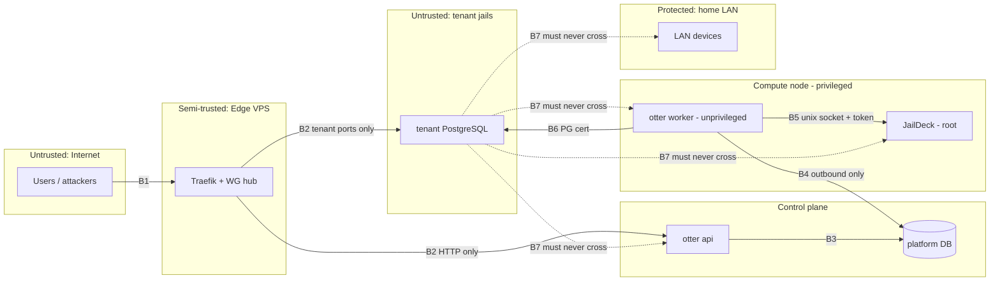

# Security Model

Status: **proposal for review**, revision 2 (2026-10-19): JailDeck as host
agent, control plane / compute node split.

This is a lightweight threat model for a small deployment: practical
controls, explicit residual risks, and nothing enterprise-grade that one
operator cannot run.

**Baseline assumption:** beta users are trusted people, but **their workloads,
credentials and devices are not**. Every tenant is treated as potentially
hostile to the host, to other tenants, and to the home network.

## 1. Assets

| Asset | Why it matters |
|---|---|
| **Residential LAN** (the operator's home network and devices) | Personal impact; the most important thing to protect |
| **Root on a compute node**, including each node's **JailDeck token** | Full control of that node's tenants |
| Customer data in instances, plus their snapshots and backups | Confidentiality and integrity for customers |
| Platform DB (control plane) | Users, password hashes, sessions, subscriptions, the operations queue, audit |
| Secrets | JailDeck tokens, per-node PostgreSQL admin client keys, admin CA key, DB role passwords, WireGuard keys, Cloudflare DNS API token (VPS), backup age keys and target credentials |
| Residential IP and VPS IP reputation | Abuse leads to ISP or VPS-provider action |
| VPS (edge) | Public entry point; terminates TLS, so it sees DB traffic in plaintext (Q4) |
| Node resources | One tenant must not starve others |

## 2. Threat actors

| Actor | Capability | Motivation |
|---|---|---|
| Internet scanner / bot | Port scans, credential stuffing, known CVEs | Opportunistic |
| Malicious or compromised tenant | Valid account; SQL in its own instance | Cross-tenant data, host escape, LAN access, free resources |
| Compromised customer credentials | Same as tenant, for one account | Data theft |
| Attacker who owns the VPS | Root on the edge | Pivot through WireGuard, sniff traffic |
| Attacker who owns `otter api` | Code execution in the control plane | Escalate to nodes, read the platform DB |
| Supply chain | Code execution in builds or on hosts (Go modules, npm, pkg) | Varies |
| Operator mistake | Misconfiguration, deletion, leaked secret | Accident; the most likely cause of incidents |

## 3. Trust boundaries

| ID | Boundary | Control |
|---|---|---|
| B1 | Internet → edge | nftables: only 443, 5432, 51820/udp; SSH key-only from an allowlist; Traefik rate and connection limits |
| B2 | Edge → control plane / nodes | WireGuard. PF on the control plane allows the edge only to `otter-api:8080`. PF on each node allows the edge only to tenant `:5432`. **The edge is not trusted to reach anything else** |
| B3 | API → platform DB | Restricted role: no DDL, audit insert-only, cannot read node credentials (there are none in the DB) |
| B4 | Worker → platform DB | **Outbound only**: the control plane never connects to nodes. A node-specific DB role, limited to its node's operations and instances |
| B5 | Worker → JailDeck | Unix socket (mode 0660, dedicated group) plus a named JailDeck token readable only by the worker user. No TCP listener |
| B6 | Worker → tenant instance | TLS client certificate (per node); pg_hba restricts `otter_admin` to the node host IP |
| B7 | Tenant → anything | PF default-deny egress, `private` bridge members, VNET, hardened jail parameter allowlist (JailDeck JD-018) |

## 4. Attack surfaces

1. **Portal and REST API** (public via the edge): authentication, sessions,
   authorization (IDOR), input validation, CSRF, rate limits.
2. **Tenant PostgreSQL endpoints** (public via the edge): brute force,
   PostgreSQL CVEs, abuse of SQL features to reach the OS.
3. **Tenant jail → kernel**: the FreeBSD syscall surface (shared kernel).
4. **Tenant network → host, LAN, other tenants, control plane.**
5. **Edge VPS**: SSH, Traefik, kernel. It holds the DNS token and terminates
   TLS.
6. **WireGuard**: key compromise; overly broad AllowedIPs.
7. **JailDeck** on each node: its API is root-equivalent; its web UI is
   operator-facing.
8. **The operations queue as an injection channel**, from a compromised
   `otter api` to the workers.
9. **Backups**: off-site credentials and keys.
10. **Supply chain**: Go modules, npm, FreeBSD packages.

## 5. Major risks and MVP mitigations

| # | Risk | L / I | MVP mitigation | Residual |
|---|---|---|---|---|
| R1 | Tenant reaches the **home LAN** or management network | Med / **Critical** | Tenant bridge has no physical NIC; routed design; static PF blocks tenant → RFC 1918, LAN, management, host, control plane (logged); no egress for PostgreSQL jails; isolation script in M0 and on every PF change | Future misconfiguration. Scheduled isolation script with alerting (M7) |
| R2 | Jail escape via a kernel bug | Low–Med / Critical | Customers have **no shell** (managed PostgreSQL, no superuser, no `COPY PROGRAM`, no untrusted PLs); jail parameter allowlist; no nullfs between tenants; `securelevel=3`; prompt patching | Shared kernel remains. Acceptable for managed services; arbitrary code needs VMs |
| R3 | IDOR: user A acts on user B's instance | Med / High | Every query is scoped by the session's `account_id`; 404 for foreign ids; table-driven authorization tests per endpoint; no operator functions over HTTP | New-endpoint bugs. Tests are part of the definition of done |
| R4 | **Compromised `otter api` escalates to nodes** | Low–Med / Critical | Control plane holds **no node credential** and **has no route** to any node; workers accept only fixed operation kinds; every field a worker uses is re-validated (slug regex, flavor in DB, platform-generated jail name and IP within the node's subnet); the worker builds the JailDeck spec from **its own config** plus validated values, never from free-form DB content | A compromised api can queue legitimate-looking creates and deletes for any customer (data destruction). Mitigation: snapshots and dumps; delete leaves a final snapshot (Q7) |
| R5 | JailDeck compromised (exposed API/UI, token theft, bug) | Low / Critical | Unix socket only for automation; UI bound to loopback or the management LAN, operator access via SSH forward; token in a `0400` file owned by the worker user; JailDeck's own design (mandatory auth, argon2id, bounded commands, argv-only exec, param allowlist) | Root-equivalent API by design (JD-001). Small, known codebase you control |
| R6 | Brute force against portal or PostgreSQL endpoints | High / Med | argon2id; login rate limit per IP and account; 32-character generated PostgreSQL passwords; Traefik per-instance connection and rate limits | No client-IP visibility at PostgreSQL |
| R7 | Resource exhaustion by one tenant | Med / Med | Flavor-derived PostgreSQL limits (`max_connections`, `shared_buffers`, `work_mem`, `statement_timeout`, `temp_file_limit`); rctl `memoryuse`/`vmemoryuse`/`maxproc`/`openfiles`/`pcpu`; cpuset; `refquota` on `data`; no memory overcommit; node capacity check | Disk I/O not limited in the MVP; noisy neighbours on HDDs. Monitored |
| R8 | Credential exposure | Med / High | Customer passwords never stored (shown once; SCRAM verifiers only, payload cleared); secrets in `0400` files, never in Git, env dumps or logs; slog redaction; session tokens stored hashed; JailDeck exec argv never contains secrets | Secrets at rest on home machines |
| R9 | **Edge compromise** | Low–Med / High | Minimal VPS (Traefik, WireGuard, nftables); key-only SSH; unattended upgrades; nodes and control plane treat `wg0` as untrusted; DNS token scoped to one zone; Traefik *pulls* config (no platform credentials on the VPS) | With TLS terminated at the edge, DB traffic and passwords are readable there (Q4). Passthrough deferred |
| R10 | Backup theft or tampering | Low / High | Client-side age encryption above the `Target` interface (no target sees plaintext); nodes hold only the **public** key, the private key is offline; per-node target credentials scoped to the node's prefix, without delete where supported (object lock); sha256 checked on restore | Losing the offline private key means losing every off-site backup; keep two offline copies. With the `none` target there is no off-site copy at all, which the beta terms must state |
| R11 | Abuse from tenant workloads | Low (PG only) / Med | PostgreSQL jails have no egress; future VMs egress via the edge only, with 25/465/587 blocked and rate limits | Higher once VMs launch |
| R12 | Operator error deletes data | Med / High | Soft delete plus a final snapshot window (Q7); JailDeck destroy requires `confirm=<name>`; destructive admin CLI commands require typing the name; snapshots; dumps; drills | Human factor |
| R13 | Supply chain | Low / High | Few dependencies; lockfiles committed; `govulncheck` / `npm audit` in CI; official pkg repo only; pinned JailDeck version per node | Inherent |
| R14 | Physical access to home hardware | Low / Med | Documented to users | Deferred: per-tenant ZFS encryption |
| R15 | Compromised node escalates to other nodes or the control plane | Low / High | Per-node DB role (own rows only); per-node client certificate and JailDeck token; WireGuard AllowedIPs per node; nodes never talk to each other | The node's DB role can still corrupt its own instances' records |
| R16 | **Non-Otter jails on a node reach tenants.** The operator's own jails on a node, if they use `ip4=inherit` or a LAN alias and `allow.raw_sockets`, send their traffic from the host stack and matches any "host → tenant" PF pass | Med / Med | PF passes to tenant :5432 only from the worker's and the edge's addresses, never from "self" broadly. Before beta, either move such jails to VNET on a separate bridge, or move them off tenant nodes. Drop `allow.raw_sockets` where it isn't needed | Until then a compromise of a personal service is one hop from tenant databases (still behind SCRAM auth) |

## 6. Specific controls

### Authentication and sessions (customers)

- Invite-only sign-up (operator-created, single-use token, 72-hour expiry).
- argon2id; minimum 12 characters; a small breached-password list.
- Server-side sessions: a 256-bit random token in an `HttpOnly; Secure;
  SameSite=Lax` cookie, stored hashed. Idle timeout 7 days, absolute 30
  days. Rotated on login, revoked on logout.
- CSRF: SameSite plus an `Origin` check or double-submit token on unsafe
  methods.
- TOTP: right after the MVP (M8), before any paid plan.

### Authorization

- Two roles: customer (scoped to own account) and operator. Operator
  capabilities exist **only in `otter admin`** (shell access to the
  control plane or a node). No operator endpoints over HTTP.
- Data access goes through functions that take the session's account id.

### API hardening

- Body size limits; strict JSON (unknown fields rejected); allowlist
  validation for every field.
- Rate limits: per IP on authentication endpoints; per account on mutations
  (e.g. 10 creates per hour).
- CSP `default-src 'self'`, `frame-ancestors 'none'`, HSTS at Traefik.
- Errors never leak internal errors, JailDeck responses, or stack traces.

### Secrets

| Secret | Location | Access |
|---|---|---|
| JailDeck token (per node) | Node, file owned by the worker user, `0400` | worker on that node |
| PostgreSQL admin client key (per node) | Node, worker user, `0400` | worker on that node |
| Admin CA private key | **Offline**; used only to issue or rotate node client certificates | operator |
| Platform DB passwords (api role, one role per node) | Control plane / respective node | per process |
| WireGuard private keys | Each host, root `0600` | root |
| Cloudflare API token | VPS, Traefik ACME; `Zone:DNS:Edit` on `otter-labs.com` only | Traefik |
| Backup age key pair | Public key on each node and the control plane; private key offline (two copies) | worker (encrypt) / operator (restore) |
| Backup target credentials | Per node, scoped to that node's prefix or directory | worker |
| Customer PostgreSQL password | **Nowhere** (shown once; reset generates a new one) | customer |

Rotation procedures for each are documented in M7.

### Secure provisioning

- The only customer input reaching a node is a validated slug (as a display
  name) and a flavor code. Jail names, IPs, sizes and parameters are
  platform-generated or come from worker-side config.
- The jail parameter allowlist is enforced **in JailDeck** (defence in
  depth: even a buggy worker cannot request `allow.mount` or
  `allow.raw_sockets`).
- Templates are built by script from official packages; versions are
  recorded.
- PostgreSQL listens only on the tenant IP; pg_hba rejects by default.

### Secure deprovisioning

- JailDeck destroy removes the root and `data` datasets and the config. The
  worker verifies absence through inventory.
- Tenant IPs and jail names are not reused for a quarantine period (e.g. 7
  days). Edge routes vanish at the next config poll.
- Final snapshots (Q7) are destroyed on schedule, and the destruction is
  audited.
- Dumps of deleted instances age out under normal retention. The privacy
  notice says so.

### Audit

- **Platform audit (control plane):**
  - logins (including failures);
  - password events;
  - instance lifecycle;
  - subscription changes;
  - operator CLI actions;
  - reconciler actions;
  - authorization denials.

  Append-only at the DB-permission level; kept at least 1 year.
- **Node audit (JailDeck JSON-lines log):** every system mutation, with the
  `X-Request-Id` linking it to the platform operation.

## 7. Jails vs. bhyve for customer workloads

| | FreeBSD jail | bhyve VM |
|---|---|---|
| Kernel | Shared with host | Separate guest kernel |
| Escape requires | One reachable kernel bug, or a jail misconfiguration | Bug in `vmm.ko` or bhyve device emulation (Capsicum-sandboxed) |
| Recent advisories | SA-26:02, SA-26:04 (nullfs-related configurations) | 2024 bhyve advisories (TPM, XHCI), fixed by 15.0 |
| Overhead | Near zero | ~100–200 MB per VM plus guest OS; slower I/O on older CPUs without APICv |
| Fit | **Managed services; customer has no shell** | **Customer runs arbitrary code** |

Jails mitigate:

- cross-tenant filesystem access;
- network reach;
- resource abuse (partially);
- process visibility.

They leave:

- kernel escapes;
- noisy-neighbour I/O;
- CPU side channels.

**Recommendation:** jails for managed PostgreSQL, Redis, RabbitMQ, OtterMQ
and GoodiesDB. bhyve for anything with shell access. A future service that
runs customer-supplied code must be re-evaluated (Q13).

## 8. Deferred security improvements

1. TOTP 2FA.
2. Scheduled isolation regression test with alerting (a manual script exists
   in the MVP).
3. Per-tenant ZFS native encryption.
4. TLS passthrough to per-instance certificates (edge no longer sees
   plaintext).
5. Customer IP allowlists at Traefik.
6. rctl I/O throttling.
7. Object-lock off-site backups.
8. External review or pentest before payments.
9. Signed template builds.
10. Hardware-key SSH for operators.

## 9. Security checklist for the beta gate (M7)

- [ ] JailDeck: automation over the unix socket only; UI not reachable from
      the edge or tenants; token file `0400`
- [ ] The control plane has no route to node management addresses (verified
      with `nc` from the `otter-api` jail)
- [ ] Isolation script passes: from a tenant jail, the LAN, the host, the
      control plane, other tenants and the internet are unreachable
- [ ] From the edge over `wg0`, only `otter-api:8080` and tenant `:5432` are
      reachable
- [ ] Authorization tests cover every endpoint (cross-account access returns 404)
- [ ] Login rate limiting verified
- [ ] No secrets in Git history, logs, audit details or JailDeck audit
      entries (grep)
- [ ] Restore drills done (instance, platform DB, node rebuild)
- [ ] FreeBSD, JailDeck, Traefik and PostgreSQL versions recorded;
      advisories subscribed
- [ ] Privacy notice and beta terms published (Q15)
